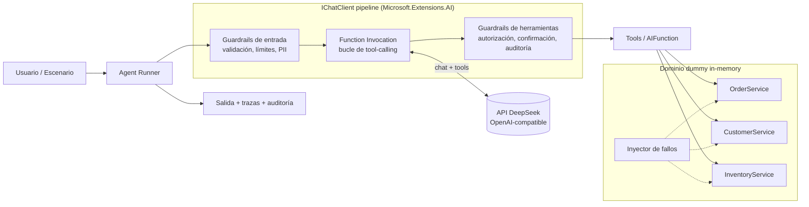

# Agentic AI Sandbox · .NET 10 + DeepSeek

Laboratorio de arquitectura para validar, mediante una prueba de concepto (PoC), la integración de **IA agéntica en procesos transaccionales empresariales** (estilo ERP/CRM).

El motor de razonamiento y de invocación de herramientas (*Function Calling*) es la **API de DeepSeek**, consumida a través de [`Microsoft.Extensions.AI`](https://learn.microsoft.com/dotnet/ai/microsoft-extensions-ai) (`IChatClient`).

> **Esto no es un ERP.** No se integra ningún sistema real. La lógica de negocio vive en servicios de dominio *in-memory* (dummy) que simulan validaciones, fallos inducidos y cambios de estado, para poder estudiar cómo se comporta un agente frente a ellos.

## Objetivos del laboratorio

- Validar el patrón *LLM como orquestador, dominio como fuente de verdad*.
- Comprobar que las herramientas (`AIFunction`) exponen un contrato estable y seguro al modelo.
- Diseñar y probar **guardrails** (validación, límites, confirmación humana, auditoría) como middleware del pipeline.
- Observar el comportamiento del agente ante errores deterministas, datos inválidos e intentos de acción no permitida.
- Obtener casos de prueba reproducibles, incluso sin llamar a DeepSeek (cliente simulado).

## Arquitectura



Versión ASCII:

```
 Usuario/Escenario
        │
        v
  ┌───────────┐     ┌─────────────────────────────────────────────┐
  │  Agent    │────>│ IChatClient pipeline                        │
  │  Runner   │     │ [Guardrails entrada] -> [FunctionInvocation]│<──> API DeepSeek
  └───────────┘     │            └─> [Guardrails de tools]        │
        ^           └──────────────────────┬──────────────────────┘
        │                                  v
   Salida/Trazas                    Tools (AIFunction)
                                           v
                          Servicios de dominio dummy (in-memory)
                          Orders · Customers · Inventory · Fallos
```

### Principios clave

- El **LLM nunca toca el dominio directamente**: solo a través de tools finas que delegan en servicios.
- Las **reglas de negocio** viven en el dominio, nunca en prompts.
- Los errores de negocio se devuelven al modelo como **resultados tipados**, no como excepciones.

## Requisitos previos

- Un motor de contenedores: [Docker](https://www.docker.com/products/docker-desktop) o [Podman](https://podman.io/). Es la referencia para construir, probar y ejecutar.
- [.NET 10 SDK](https://dotnet.microsoft.com/download) (10.0.100 o posterior) para el ciclo de desarrollo local rápido. `dotnet test` usa Microsoft.Testing.Platform, que se configura en `global.json`.
- Una **API key de DeepSeek** ([platform.deepseek.com](https://platform.deepseek.com))
- [Node.js](https://nodejs.org) (LTS) y [OpenSpec](https://github.com/Fission-AI/OpenSpec) para el flujo de trabajo guiado por especificaciones:

  ```bash
  npm install -g @fission-ai/openspec@latest
  openspec --version
  ```
- (Opcional) IDE con soporte para .NET 10: Visual Studio 2026, Rider o VS Code + C# Dev Kit

## Guía rápida

```bash
# 1. Clonar
git clone <url-del-repo> agentic-ai-sandbox
cd agentic-ai-sandbox

# 2. Configurar la API key (User Secrets, nunca en el repo)
dotnet user-secrets init --project src/Sandbox.Runner
dotnet user-secrets set "DeepSeek:ApiKey" "<tu-api-key>" --project src/Sandbox.Runner

# 3. Compilar y probar
dotnet build
dotnet test

# 4. Ejecutar un escenario
dotnet run --project src/Sandbox.Runner -- --scenario create-order
```

Alternativa por variable de entorno: `DEEPSEEK__APIKEY=<tu-api-key>`.

Configuración por defecto (`appsettings.json`):

```json
{
  "DeepSeek": {
    "Endpoint": "https://api.deepseek.com",
    "Model": "deepseek-chat"
  }
}
```

> Los endpoints y modelos disponibles pueden cambiar; consulta la documentación oficial de DeepSeek. Verifica el soporte de *function calling* del modelo elegido antes de usarlo en un escenario.

## Ejecución con contenedores

Lo que se desarrolla se construye, prueba y ejecuta también en contenedor. El flujo es **híbrido**: `dotnet` local para iterar rápido y el contenedor como referencia para dar algo por terminado y como base de la CI.

```bash
# Tests dentro del contenedor (la etapa de tests se ejecuta sin red ni API key)
docker build --target test .

# Imagen final y ejecución del Runner (one-shot, endurecido y sin red)
docker compose run --build --rm runner
```

Hoy el Runner no hace nada y devuelve 0. Los escenarios (`--scenario <id>`) llegan en la fase 4, y la conexión con DeepSeek, que abrirá la red del `runner`, en la fase 2. La API key se pasará como secreto por fichero (`secrets/deepseek_api_key`, ignorado por Git), nunca dentro de la imagen. Detalle, mediciones y razones en [`docs/learn/07-contenedores-en-sistemas-agenticos.md`](docs/learn/07-contenedores-en-sistemas-agenticos.md).

## Integración continua

Cada pull request y cada push a `main` ejecutan [`.github/workflows/ci.yml`](.github/workflows/ci.yml). Sus tres jobs son checks obligatorios para fusionar en `main`:

| Check | Qué comprueba |
|---|---|
| `test` | `docker build --target test`: compilación y tests, igual que en local |
| `image` | La imagen final arranca con las restricciones del `runner` y no tiene vulnerabilidades altas o críticas con arreglo (Grype) |
| `openspec` | `openspec validate --all --strict` |

Dependabot propone cada semana las actualizaciones de NuGet, de las imágenes base y de las acciones, y las de seguridad en cuanto se publican. Para validar las specs sin instalar Node, puedes usar la misma imagen que la CI:

```bash
docker build -t openspec-cli tools/openspec
docker run --rm --network none -v "$PWD:/repo:ro" openspec-cli validate --all --strict
```

Detalle en [`docs/learn/09-integracion-continua-y-cadena-de-suministro.md`](docs/learn/09-integracion-continua-y-cadena-de-suministro.md) y en el [ADR 0002](docs/adr/0002-checks-obligatorios-y-politica-de-vulnerabilidades.md).

## Documentación de aprendizaje

Este laboratorio sirve también para **aprender** los conceptos que valida. La carpeta [`docs/learn/`](docs/learn/README.md) es el cuaderno de estudio y crece en paralelo al código:

- [IA agéntica en procesos transaccionales](docs/learn/01-ia-agentica-en-sistemas-transaccionales.md): cómo adaptar un ERP/CRM y qué enfoques existen.
- [Motor de razonamiento e invocación de herramientas](docs/learn/02-motor-de-razonamiento-y-herramientas.md)
- [Function Calling](docs/learn/03-function-calling.md)
- [Herramientas de Microsoft](docs/learn/04-herramientas-microsoft.md), con tabla de referencia.
- [Guardrails](docs/learn/05-guardrails.md) y patrones de implementación.
- [Autenticación y autorización de agentes](docs/learn/06-autenticacion-y-autorizacion.md) con datos sensibles.
- [Contenedores en sistemas agénticos](docs/learn/07-contenedores-en-sistemas-agenticos.md): diseño, secretos, endurecimiento y coste.
- [Estructura y estándares de la solución .NET](docs/learn/08-estructura-y-estandares-de-la-solucion-dotnet.md): capas, SDK, paquetes, saltos de línea y globalización invariante.
- [Integración continua y cadena de suministro](docs/learn/09-integracion-continua-y-cadena-de-suministro.md): CI, checks obligatorios, acciones fijadas por SHA, Dependabot y escaneo de imágenes.
- [Glosario](docs/learn/glosario.md)

## Flujo de trabajo con OpenSpec

El desarrollo sigue *spec-driven development* con [OpenSpec](https://github.com/Fission-AI/OpenSpec): ningún cambio de comportamiento se implementa sin una propuesta y unas especificaciones previas.

1. **Explorar** (`/opsx:explore`, recomendado si hay incógnitas técnicas): pensar y probar sin escribir artefactos ni tocar el código del repositorio; lo aprendido alimenta el `design.md`.
2. **Proponer**: crear un *change* (en Claude Code, `/opsx:propose "idea"`; por CLI, `openspec new change <nombre>`) en `openspec/changes/<nombre>/` con `proposal.md`, `tasks.md` y los *spec deltas* (requisitos y escenarios).
3. **Validar**: `openspec validate <nombre> --strict`.
4. **Implementar** (`/opsx:apply`): ejecutar las tareas de `tasks.md` y marcarlas al completarlas.
5. **Verificar y archivar** (en la misma rama, **antes de abrir el PR**): `/opsx:verify` comprueba que la implementación cumple las specs y, si no hay problemas críticos y todos los tests están en verde, `/opsx:archive` (o `openspec archive <nombre>`) fusiona los deltas en `openspec/specs/`, que pasa a ser la fuente de verdad del comportamiento actual. El PR llega ya con el change archivado y con build y tests en verde.

Comandos útiles: `openspec list`, `openspec list --specs`, `openspec show <item>`.

Cada fase de [`docs/plan.md`](docs/plan.md) se materializa en uno o varios *changes*. Los comandos exactos pueden variar según la versión instalada; consulta `openspec --help`.

## Flujo de Git

`main` está protegida. Cada cambio se desarrolla en su propia rama (`<tipo>/<descripcion>`, por ejemplo `feat/add-order-service`) y se integra mediante *pull request* con *squash merge*. Un change de OpenSpec equivale a una rama. Detalle en [`AGENTS.md`](AGENTS.md), sección 9.

## Estructura prevista del proyecto

```
agentic-ai-sandbox/
├── AGENTS.md                      # Guía para asistentes de IA
├── README.md
├── Directory.Build.props          # Nullable, LangVersion, analizadores
├── Directory.Packages.props       # Central Package Management
├── global.json                    # Fija el SDK de .NET 10
├── AgenticSandbox.slnx
├── Dockerfile                     # Multi-etapa: restore, build, test, publish, final
├── compose.yaml                   # Servicio runner (y, en la fase 5, perfil opcional de trazas)
├── .dockerignore
├── .gitattributes                 # eol=lf para Dockerfile, scripts y YAML
├── .env.example                   # Plantilla sin secretos
├── secrets/                       # Secretos locales (ignorado por Git)
├── .github/
│   ├── workflows/ci.yml           # CI: checks test, image y openspec
│   ├── workflows/measure.yml      # Medición manual nativo frente a contenedor
│   ├── dependabot.yml             # Actualizaciones semanales y de seguridad
│   └── rulesets/protect-main.json # Protección de main (se aplica con gh api)
├── tools/openspec/Dockerfile      # CLI de OpenSpec fijada, para la CI y uso local
├── openspec/
│   ├── config.yaml                # Esquema y contexto del proyecto para OpenSpec
│   ├── specs/                     # Especificaciones vigentes (fuente de verdad)
│   └── changes/                   # Propuestas en curso (+ archive/)
├── docs/
│   ├── plan.md                    # Plan de trabajo por fases
│   ├── learn/                     # Documentación de aprendizaje (en paralelo al código)
│   └── adr/                       # Decisiones de arquitectura
├── src/
│   ├── Sandbox.Domain/            # Entidades, records, reglas de negocio
│   ├── Sandbox.Application/       # Commands/Queries, servicios dummy in-memory
│   ├── Sandbox.Agents/            # Tools (AIFunction), pipeline, guardrails, runner
│   └── Sandbox.Runner/            # Host de consola: DI, config, escenarios
└── tests/
    ├── Sandbox.Domain.Tests/
    ├── Sandbox.Agents.Tests/      # Tools y guardrails con IChatClient falso
    └── Sandbox.Scenarios.Tests/   # Escenarios end-to-end deterministas
```

## Estado

Fase 1 (**Setup de solución**) completada. Siguiente: **fase 2 · Infraestructura base**. Consulta [`docs/plan.md`](docs/plan.md) y [`AGENTS.md`](AGENTS.md).

## Licencia

Distribuido bajo la [licencia MIT](LICENSE). Las dependencias conservan sus propias licencias.

## Aviso

Proyecto experimental sin garantías. No usar en producción ni con datos reales.
