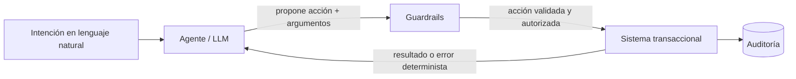

# 1. IA agéntica en procesos transaccionales empresariales

> **Estado**: documento base. **Verificado**: 2026-10-31 (conceptos de Microsoft Learn; el resto es criterio de diseño y se indica).

## Qué es y por qué es difícil

Un **proceso transaccional** (crear un pedido, reservar stock, aprobar un gasto, cancelar una factura) tiene propiedades que no se pueden negociar:

- **Invariantes de negocio**: no se vende stock que no existe; no se aprueba por encima del límite.
- **Atomicidad y consistencia**: o se hace entero o no se hace.
- **Irreversibilidad o coste de deshacer**: un envío o un pago no se "descuenta".
- **Permisos**: no todo usuario puede hacer todo.
- **Auditoría**: hay que saber quién hizo qué y por qué.

Un **LLM** tiene propiedades opuestas: es probabilístico, puede equivocarse con seguridad, puede inventar argumentos y puede ser manipulado por el texto que procesa (*prompt injection*).

**Idea central de todo el laboratorio**: separar *decidir qué hacer* (lo que el LLM hace bien: interpretar lenguaje natural, elegir pasos) de *ejecutarlo de forma válida* (lo que un sistema transaccional hace bien: validar, aplicar reglas, garantizar consistencia). El LLM propone; el dominio decide.

## Qué hay que adaptar en un sistema transaccional

Un ERP o CRM pensado para humanos y para integraciones programáticas no está listo, tal cual, para un agente. Adaptaciones habituales (criterio de diseño, no norma):

| Adaptación | Por qué |
|-----------|---------|
| **Errores deterministas y con códigos estables** (`INSUFFICIENT_STOCK`) | El agente necesita entender qué falló y decidir si reintenta; un stack trace no sirve |
| **Idempotencia** (claves de idempotencia en comandos) | Los LLM reintentan; no puede duplicarse un pedido |
| **Máquinas de estado explícitas** | Evitan transiciones inválidas (cancelar un pedido ya enviado) |
| **Separar lectura y escritura** (CQRS simplificado) | Se pueden dar permisos y guardrails distintos a cada tipo de operación |
| **Operaciones de "vista previa" / dry-run** | El agente puede proponer, el humano ver el efecto y confirmar |
| **Salidas compactas y paginadas** | El contexto del modelo es limitado y caro |
| **Operaciones con granularidad semántica** (`cancel_order`, no `update_row`) | Reducen el espacio de errores y facilitan la autorización |
| **Autorización por usuario y por recurso en el backend** | El agente no puede ser el único control de acceso (ver documento 6) |
| **Compensaciones (sagas)** para procesos de varios pasos | Si el paso 3 falla, hay que deshacer el 1 y el 2 de forma controlada |
| **Correlación y auditoría** (quién, qué, con qué argumentos, resultado) | Imprescindible para investigar y cumplir normativa |
| **Límites de negocio** (importes máximos, cantidades) en el dominio | Son la última barrera si el LLM se equivoca |

## Aproximaciones de integración

No hay una única forma de poner un agente delante de un sistema transaccional. Estas son las más habituales, de menor a mayor autonomía:

### A. Copiloto de solo lectura (consulta y explicación)
El agente solo ejecuta *queries*. Puede combinarse con RAG sobre documentación o datos.
- **Ventajas**: riesgo bajo (no cambia estado), rápido de implantar, valor inmediato.
- **Inconvenientes**: no automatiza la acción; sigue habiendo fuga de datos si no se controla el acceso.
- **Cuándo**: punto de partida casi siempre.

### B. Agente que invoca una capa de capacidades (tools sobre servicios)
Se crea una **fachada pensada para agentes** (las *tools*) que delega en los servicios de dominio existentes. El LLM elige qué tool llamar y con qué argumentos; el dominio valida. **Es el enfoque de este sandbox.**
- **Ventajas**: flexible, el LLM maneja la variabilidad del lenguaje, el dominio conserva el control, fácil de auditar por tool.
- **Inconvenientes**: el agente decide el orden de los pasos, así que es menos predecible; exige buen diseño de tools y guardrails.
- **Cuándo**: procesos con variabilidad de entrada pero con reglas claras en el backend.

### C. Workflow determinista con pasos de LLM (LLM dentro del flujo)
El flujo (BPM, máquina de estados, código) lo controla el sistema; el LLM solo resuelve pasos concretos: extraer datos de un correo, clasificar, redactar. Anthropic distingue *workflows* (caminos predefinidos) de *agents* (el LLM dirige su propio proceso) y recomienda empezar por lo más simple (referencia externa, **no verificada** en esta sesión).
- **Ventajas**: predecible, testeable, auditable, barato. El riesgo queda acotado a cada paso.
- **Inconvenientes**: rígido; no se adapta a casos fuera del flujo.
- **Cuándo**: procesos estables y repetitivos, con alto coste de error. **Suele ser la mejor opción si el proceso se puede dibujar de antemano.**

### D. Agente que propone, humano que confirma (*human-in-the-loop*)
El agente prepara la acción completa y la deja pendiente de aprobación. Solo se ejecuta tras la confirmación explícita. Microsoft Agent Framework lo soporta con funciones que requieren aprobación (`ApprovalRequiredAIFunction`, `ToolApprovalRequestContent`).
- **Ventajas**: reduce mucho el riesgo en acciones sensibles o irreversibles; da confianza.
- **Inconvenientes**: la fricción humana limita la velocidad; el humano puede aprobar sin mirar (fatiga de aprobación).
- **Cuándo**: acciones destructivas, de dinero o de permisos. Se combina con B o C.

### E. Agente autónomo disparado por eventos
El agente reacciona a eventos (cola, webhook, cron) con identidad propia y sin humano en cada paso.
- **Ventajas**: automatización real, escala.
- **Inconvenientes**: el mayor riesgo; requiere identidad propia con mínimo privilegio, límites estrictos, observabilidad y *kill switch*.
- **Cuándo**: tareas de bajo riesgo y reversibles, tras haber validado el patrón con humano en el bucle.

### F. Integración vía protocolo estándar (MCP)
En vez de tools locales, el sistema se expone como servidor **Model Context Protocol**, y cualquier cliente compatible lo consume. Hay un SDK oficial de C# mantenido por Microsoft, Anthropic y la organización MCP.
- **Ventajas**: estándar, reutilizable entre agentes y clientes, desacopla el sistema del agente.
- **Inconvenientes**: añade una capa y un modelo de seguridad propio (autorización en transportes HTTP); no sustituye los guardrails.
- **Cuándo**: cuando varios agentes o aplicaciones necesitan acceder al mismo sistema.

### G. Agente que opera la interfaz (RPA / *computer use*)
El agente maneja la UI como un humano.
- **Ventajas**: sirve cuando no existe API.
- **Inconvenientes**: frágil, lento, difícil de auditar y de proteger.
- **Cuándo**: último recurso para sistemas heredados sin API.

## Comparativa

| Enfoque | Autonomía | Riesgo | Predecibilidad | Esfuerzo de integración | Encaja con |
|---------|-----------|--------|----------------|-------------------------|-----------|
| A. Copiloto lectura | Baja | Bajo | Alta | Bajo | Consulta, soporte |
| B. Tools sobre servicios | Media | Medio | Media | Medio | Procesos con variabilidad |
| C. Workflow + LLM | Baja-media | Bajo-medio | Alta | Medio | Procesos estables |
| D. Propone y confirma | Media | Bajo en escrituras | Media-alta | Medio | Acciones sensibles |
| E. Autónomo por eventos | Alta | Alto | Baja | Alto | Tareas reversibles y acotadas |
| F. MCP | Depende | Depende | Depende | Medio-alto | Reutilización entre agentes |
| G. UI / RPA | Media | Medio-alto | Baja | Medio | Sistemas sin API |

## ¿Cuáles se usan con más eficacia y eficiencia?

No tengo una estadística fiable de adopción y no la voy a inventar. Lo que sí es consenso razonable en la guía de buenas prácticas, y por tanto **criterio recomendado** para este proyecto:

1. **Escalera de adopción**: empezar por A, pasar a C o B con D para las escrituras sensibles, y reservar E para cuando haya evidencia y controles.
2. **Mayor autonomía solo con menor riesgo**: cuanto más caro o irreversible sea el error, más control determinista y más humano.
3. **Lo más simple que funcione**: si el proceso se puede expresar como flujo, un workflow con pasos de LLM (C) suele ser más barato, rápido y fiable que un agente libre (B/E).
4. **Los enfoques se combinan**: lo habitual es B o C con D en las acciones críticas, y F cuando hay varios consumidores.

## Qué valida este sandbox

- **Núcleo**: enfoque **B** (tools sobre servicios de dominio dummy) con **D** (confirmación en acciones destructivas) como guardrail.
- **Comparación posterior** (hipótesis a explorar): reescribir un caso como **C** (workflow + LLM) y comparar fiabilidad, coste y número de llamadas.
- **No cubierto** en la PoC inicial: E (eventos autónomos), F (MCP) y G (UI).

Preguntas que la PoC debe poder responder con evidencia:

- ¿Cuántas llamadas y tokens cuesta un proceso típico con B frente a C?
- ¿Con qué frecuencia propone argumentos inválidos el modelo y cómo se recupera?
- ¿Qué parte de las reglas puede quedarse fuera del prompt sin perder fiabilidad?
- ¿Qué guardrails bloquean de verdad los casos de manipulación (prompt injection)?

## Errores típicos

- Meter reglas de negocio en el prompt y confiar en que el modelo las cumpla.
- Dar al agente permisos de "superusuario" por comodidad.
- Exponer operaciones genéricas (`execute_sql`, `update_any`) en lugar de operaciones semánticas.
- No definir qué hace el agente cuando el dominio devuelve un error.
- Dejar que el único control de acceso sea la propia decisión del LLM.

## Referencias

- Agentes y workflows (conceptos): <https://learn.microsoft.com/dotnet/ai/conceptual/agents>
- Aprobación humana de herramientas en Agent Framework: <https://learn.microsoft.com/agent-framework/agents/tools/tool-approval>
- Patrón de mínimo privilegio para agentes: <https://learn.microsoft.com/security/zero-trust/sfi/least-privilege-for-ai-agents>
- MCP en .NET: <https://learn.microsoft.com/dotnet/ai/get-started-mcp>
- "Building effective agents" (Anthropic, workflows frente a agentes): **no verificado** en esta sesión.
