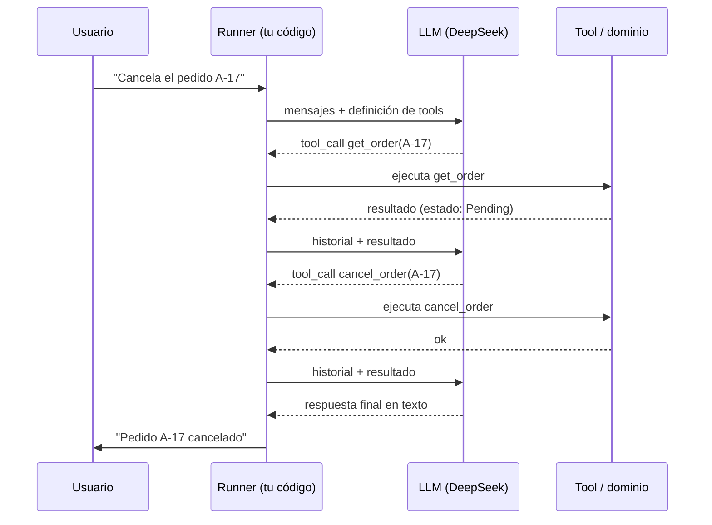

# 2. Motor de razonamiento e invocación de herramientas

> **Estado**: documento base, ampliado en la fase 4 (`add-sales-agent`) con las trazas reales del bucle. **Verificado**: 2026-10-31 contra Microsoft Learn (`IChatClient`, `FunctionInvokingChatClient`), y el 2026-11-02 con ejecuciones reales del Runner contra `deepseek-flash`.

## Qué es

En un sistema agéntico, el **LLM actúa como motor de decisión** dentro de un bucle. En cada vuelta decide una de dos cosas:

1. **Responder** al usuario (fin del bucle), o
2. **Pedir que se ejecute una herramienta** con unos argumentos concretos.

El modelo **no ejecuta nada**. Solo produce texto estructurado que dice "llama a `get_order` con `{"orderId": "A-17"}`". Quien ejecuta es **tu aplicación**, y devuelve el resultado al modelo para que decida el siguiente paso. Microsoft lo describe así: el modelo "devuelve una salida estructurada que describe qué herramientas llamar y con qué argumentos; tu aplicación invoca esas herramientas y envía los resultados de vuelta".

## El bucle agéntico



Puntos clave:

- **El modelo no tiene estado**: en cada llamada se reenvía **todo el historial** (mensajes, llamadas a tools y resultados). El "estado" de la conversación vive en tu aplicación.
- **El bucle lo gobierna el cliente**, no el modelo. En .NET lo hace `FunctionInvokingChatClient` (ver documento 4).
- **Cada vuelta es una llamada de red** con su latencia y su coste en tokens. Un proceso de cinco pasos son, como mínimo, seis llamadas.

## Patrones de razonamiento

| Patrón | Idea | Comentario |
|--------|------|-----------|
| **ReAct** (razonar y actuar) | El modelo alterna pensar el siguiente paso y actuar con una tool, observando el resultado | Es lo que ocurre implícitamente en un bucle de function calling |
| **Plan y ejecución** | Primero genera un plan completo, luego se ejecuta paso a paso | Más predecible; permite validar el plan *antes* de actuar, útil como guardrail |
| **Reflexión / autocorrección** | El modelo revisa su propio resultado o error y reintenta | Se apoya en errores claros devueltos por las tools |
| **Descomposición multi-agente** | Varios agentes especializados | Fuera del alcance inicial (ver backlog) |

## Modelos de chat y modelos de razonamiento

- Un modelo **de chat** responde directamente.
- Un modelo **de razonamiento** genera una cadena de pensamiento interna antes de responder. Suele mejorar tareas complejas, pero **cuesta más y tarda más**.
- DeepSeek ofrece ambos tipos de modelo. **(No verificado)**: qué modelo concreto soporta function calling y en qué condiciones. Esto se comprueba en la fase 2 con la documentación oficial de DeepSeek y una prueba real, antes de elegir modelo para los escenarios.

Criterio de partida: usar el modelo de chat para el bucle de tools; probar el de razonamiento como experimento comparativo.

## Qué decide el modelo y qué no

| Responsabilidad | Quién |
|-----------------|-------|
| Interpretar la petición en lenguaje natural | Modelo |
| Elegir qué tool llamar y en qué orden | Modelo (propone) |
| Rellenar los argumentos | Modelo (**puede equivocarse o inventarlos**) |
| Validar argumentos y reglas de negocio | **Código** (tool + dominio) |
| Decidir si el usuario puede hacerlo | **Código** (autorización) |
| Ejecutar y garantizar consistencia | **Código** (dominio) |
| Limitar iteraciones, coste y acciones | **Código** (guardrails) |
| Redactar la respuesta final | Modelo |

Microsoft lo advierte explícitamente: "los modelos pueden alucinar argumentos que no se describieron en tus definiciones de función". Por eso la validación nunca se delega.

## Límites a tener presentes

- **No determinismo**: la misma entrada puede producir llamadas distintas. Las pruebas críticas usan un cliente falso (ver fase 6).
- **Alucinación de argumentos y de herramientas**.
- **Ventana de contexto**: el historial crece; hay técnicas de reducción (en `Microsoft.Extensions.AI`, `MessageCountingChatReducer` y `SummarizingChatReducer`, marcadas como experimentales).
- **Coste y latencia** proporcionales al número de vueltas. Las definiciones de tools **también consumen tokens**.
- **Bucles sin fin**: un modelo puede insistir en llamar a una tool que falla.

## En este proyecto

Desde la fase 4 (change `add-sales-agent`):

- **El agente no implementa el bucle a mano**: delega en `FunctionInvokingChatClient`. `SalesAgent` le pasa las instrucciones del sistema, la petición y las seis tools, y recoge el resultado.
- **El bucle sigue con sus límites por defecto**: en la librería, `MaximumIterationsPerRequest` vale 40 y `MaximumConsecutiveErrorsPerRequest` vale 3. Fijar valores propios, mucho menores, es un guardrail de la fase 5.
- **Las trazas del bucle se registran sin argumentos**: una entrada por tool (nombre, resultado y duración), los textos que el modelo emite entre llamadas y los tokens de cada llamada. Al final, el Runner muestra la respuesta y un resumen.

### Trazas reales (fase 4, `deepseek-flash`, sin razonamiento)

`--scenario happy-order` ("Hola, quiero pedir dos tazas rojas, por favor."), el 2026-11-02:

```
llamada 1  1.212 tokens de entrada, 22 de salida  -->  pide list_products
           list_products: OK en 28 ms
llamada 2  1.492 tokens de entrada, 84 de salida  -->  pide place_order (2 x SKU-MUG-RED)
           place_order: OK en 29 ms
llamada 3  1.758 tokens de entrada, 58 de salida  -->  responde: "Pedido ORD-0001 confirmado..."
total      3 llamadas, 4.462 de entrada y 164 de salida
```

Lo que enseña:

- **Cada llamada reenvía todo el historial**: los tokens de entrada crecen con cada turno (1.212, 1.492 y 1.758). La primera ya lleva unos 1.200 tokens solo de instrucciones y esquemas de tools.
- **Las tools tardan milisegundos; el modelo, segundos** (entre 1,0 y 1,7 s por llamada). En un agente, el coste y la latencia son del modelo.
- **El modelo escribe texto entre llamadas** ("Voy a buscar el producto en el catálogo."). `response.Text` lo concatena con la respuesta final, así que el Runner muestra solo el último mensaje y registra los demás.
- **Puede pedir varias tools a la vez**: en el spike pidió `list_products` y `get_customer` en una misma respuesta, y el bucle las ejecutó en serie.

## Experimentos sugeridos (a documentar con resultados reales)

1. Misma petición 10 veces: ¿la secuencia de tools es siempre la misma? **(Pendiente, fase 6.)** En las 8 ejecuciones del pedido de dos tazas (5 del spike y 3 del Runner), el modelo empezó siempre por `list_products` y terminó con `place_order`. En 2, consultó además `get_customer` sin necesidad, una de ellas en la misma respuesta que `list_products`.
2. Forzar un error del dominio: ¿el modelo reintenta, se corrige o se rinde? **En parte**: con un `SERVICE_UNAVAILABLE` reintentable tras una respuesta perdida, `deepseek-flash` reintentó en 4 de 4 casos con la misma clave de idempotencia ([documento 12](12-diseno-de-tools-para-llms.md#idempotencia-en-manos-del-modelo)). Los errores no reintentables quedan para la fase 6.
3. Dar al modelo una tool innecesaria: ¿la usa? **A veces**: las llamadas a `get_customer` del punto 1.
4. Comparar modelo de chat y de razonamiento en una petición ambigua. **(Pendiente.)** Con el razonamiento activado y tools, el adaptador no reenvía el razonamiento que DeepSeek exige, aunque la API respondió igualmente ([documento 04](04-herramientas-microsoft.md)).

## Referencias

- Uso de `IChatClient` y tool calling: <https://learn.microsoft.com/dotnet/ai/ichatclient#tool-calling>
- Tool calling en Microsoft.Extensions.AI: <https://learn.microsoft.com/dotnet/ai/conceptual/calling-tools>
- Propiedades del bucle: <https://learn.microsoft.com/dotnet/api/microsoft.extensions.ai.functioninvokingchatclient.maximumiterationsperrequest>
- ReAct (Yao et al., 2022): **no verificado** en esta sesión.
