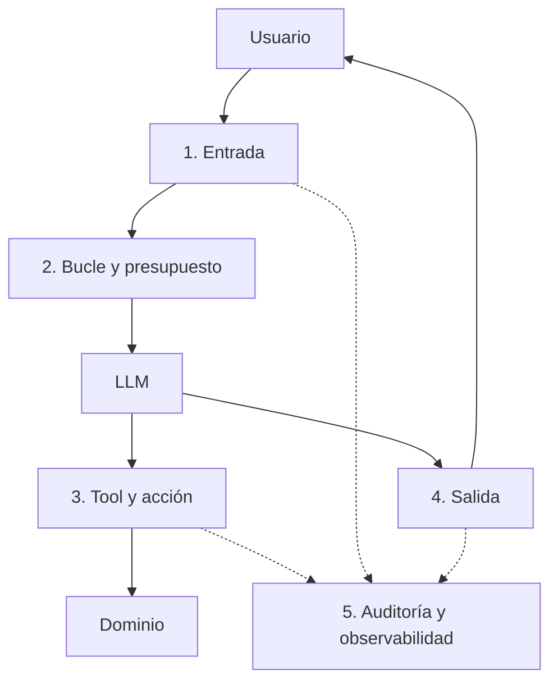

# 5. Guardrails: en qué consisten y qué patrones existen

> **Estado**: documento base. **Verificado**: 2026-10-31 para lo que atañe a Microsoft Learn; las referencias externas se marcan. La clasificación en capas es **síntesis propia** pensada para este proyecto, no un estándar.

## Qué son

Un **guardrail** es un control que limita lo que un sistema de IA puede recibir, decidir o hacer, para mantenerlo dentro de un comportamiento aceptable. El LLM es **probabilístico y manipulable**; los guardrails son la parte **determinista** que reduce el riesgo.

Regla de oro: **un guardrail de seguridad no puede depender de que el modelo "se porte bien"**. Si el control se escribe solo en el prompt, el modelo lo puede ignorar o ser convencido de saltárselo. Los controles que importan se aplican **en código, fuera del modelo**.

Microsoft lo dice en la documentación de `IChatClient`: las implementaciones no traen salvaguardas por sí mismas y la aplicación debe implementar protecciones frente a *prompt injection*, tamaño de datos y número de mensajes.

## Dónde actúan: capas

### 1. Guardrails de entrada
Controlan lo que llega al modelo.
- Validación y límites de tamaño.
- Detección y enmascarado de datos personales (PII) antes de enviarlos.
- Delimitación del alcance (rechazar temas fuera de dominio).
- Detección de *prompt injection* (clasificadores o heurísticas). **No es infalible**: es una capa más, nunca la única.

### 2. Guardrails de bucle y presupuesto
Controlan cuánto puede trabajar el agente.
- Máximo de iteraciones (en la librería, `MaximumIterationsPerRequest`).
- Máximo de errores consecutivos (`MaximumConsecutiveErrorsPerRequest`).
- Presupuesto de tokens, tiempo y coste por petición.
- *Circuit breaker* si el proveedor falla o si una tool falla repetidamente.

### 3. Guardrails de tool y de acción (los más importantes)
Controlan lo que el agente puede **hacer**. Aquí ocurre el daño real.
- **Lista de permitidas** (allow-list) de tools según contexto.
- **Validación de argumentos** (formato, rango, existencia).
- **Autorización** por usuario, recurso y acción (documento 6).
- **Políticas de negocio deterministas**: importes máximos, horarios, estados permitidos.
- **Confirmación humana** para acciones destructivas o de alto impacto, **ligada a la acción y argumentos exactos**.
- **Limitación de tasa** de acciones de escritura.
- **Vista previa / dry-run** antes de ejecutar.
- **Idempotencia** para que un reintento no duplique el efecto.

### 4. Guardrails de salida
Controlan lo que sale hacia el usuario o hacia otros sistemas.
- Validación contra un esquema (salida estructurada).
- Filtrado de contenido y de datos sensibles que no deban salir.
- Comprobación de que lo afirmado está respaldado por el resultado de las tools (*grounding*).

### 5. Auditoría y observabilidad
No bloquean, pero hacen posible investigar y demostrar.
- Registro estructurado de cada tool: quién, qué, argumentos, decisión, resultado, correlación.
- Trazas y métricas (OpenTelemetry).
- Detección de anomalías y *kill switch*.

## Patrones de diseño relevantes

| Patrón | Idea | Dónde actúa |
|--------|------|-------------|
| **Mínimo privilegio** | El agente solo tiene los permisos de la tarea; lectura y escritura separadas | Identidad y tools |
| **Allow-list de acciones** | Lo no permitido explícitamente se deniega | Tool |
| **Humano en el bucle** | Aprobación explícita de acciones críticas | Tool |
| **Doble verificación determinista** | El dominio revalida todo, aunque el agente ya lo haya comprobado | Dominio |
| **Propone, valida, ejecuta** | El agente propone un plan o acción; un componente determinista lo valida; después se ejecuta | Tool/bucle |
| **Aislamiento de contenido no confiable** | El texto externo (correos, documentos) se trata como datos, nunca como instrucciones, y se evita que dé acceso a acciones sensibles | Arquitectura |
| **Reducir la "trifecta letal"** | Evitar que un mismo agente combine acceso a datos privados, contenido no confiable y capacidad de comunicar hacia fuera | Arquitectura |
| **Fail closed** | Ante duda o error de la política, se bloquea | Todas |
| **Límites duros** | Topes de iteraciones, importes, volumen | Bucle/dominio |

La "trifecta letal" y los patrones de diseño frente a *prompt injection* proceden de literatura externa reciente **(no verificada en esta sesión; se estudiará en la fase 6)**.

## Guardrails deterministas frente a probabilísticos

| Tipo | Ejemplos | Fiabilidad | Uso |
|------|----------|------------|-----|
| **Deterministas** | Allow-list, validación, límites, autorización, políticas de negocio | Alta, reproducible, testeable | **Base de la seguridad** |
| **Probabilísticos** | Clasificadores de inyección o de toxicidad, LLM como juez | Útil pero falible | Capa adicional de defensa en profundidad |

Criterio del proyecto: **lo crítico es determinista**; lo probabilístico complementa.

## Cómo se implementa en este proyecto

| Guardrail | Mecanismo en .NET | Fase |
|-----------|-------------------|------|
| Límite de iteraciones y errores | Propiedades de `FunctionInvokingChatClient` | 4-5 |
| Validación de entrada, presupuesto, auditoría | `DelegatingChatClient` registrado con `Use*` en el pipeline | 5 |
| Autorización y política por tool | Envoltorio/filtro de invocación de la tool (a confirmar) | 5 |
| Confirmación humana | Guardrail propio que devuelve un error `CONFIRMATION_REQUIRED` hasta recibir la aprobación | 5 |
| Reglas de negocio | Servicios de dominio | 3 |
| Bloqueo | `ToolError` con código estable (`BLOCKED_BY_POLICY`), no excepción | 5 |

Cada guardrail tendrá su requisito en OpenSpec con escenarios y sus tests **sin LLM**.

## Errores típicos

- Poner la política solo en el *system prompt*.
- Un único guardrail (por ejemplo, solo un detector de inyección) como defensa.
- Guardrails que lanzan excepciones en lugar de devolver un resultado que el agente pueda interpretar.
- Confirmación humana genérica ("¿continuar?") en lugar de mostrar la acción exacta.
- No probar los guardrails con ataques realistas.
- Registrar en auditoría datos sensibles en claro.

## Referencias

- Riesgos documentados de `IChatClient`: <https://learn.microsoft.com/dotnet/api/microsoft.extensions.ai.ichatclient>
- Límites del bucle: <https://learn.microsoft.com/dotnet/api/microsoft.extensions.ai.functioninvokingchatclient.maximumiterationsperrequest>
- Middleware en el pipeline: <https://learn.microsoft.com/dotnet/ai/ichatclient#custom-ichatclient-middleware>
- Mínimo privilegio y aprobaciones: <https://learn.microsoft.com/security/zero-trust/sfi/least-privilege-for-ai-agents>
- Defensa de IA en identidad y acceso: <https://learn.microsoft.com/security/zero-trust/catalog-ai-defense-capabilities/identity-access-least-privilege>
- OWASP Top 10 para aplicaciones LLM y literatura sobre prompt injection: **no verificado**, a estudiar en fase 6.
