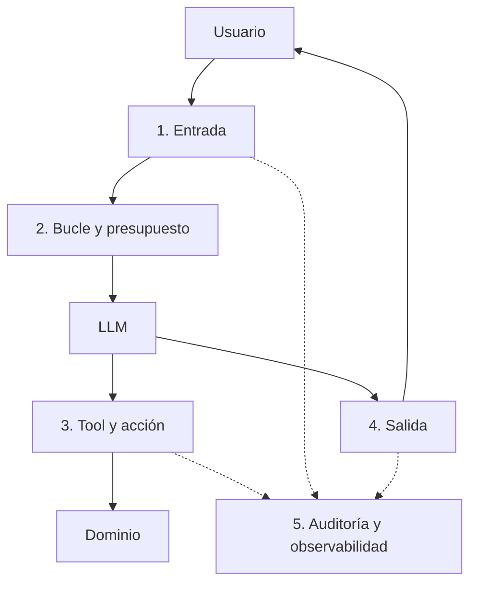
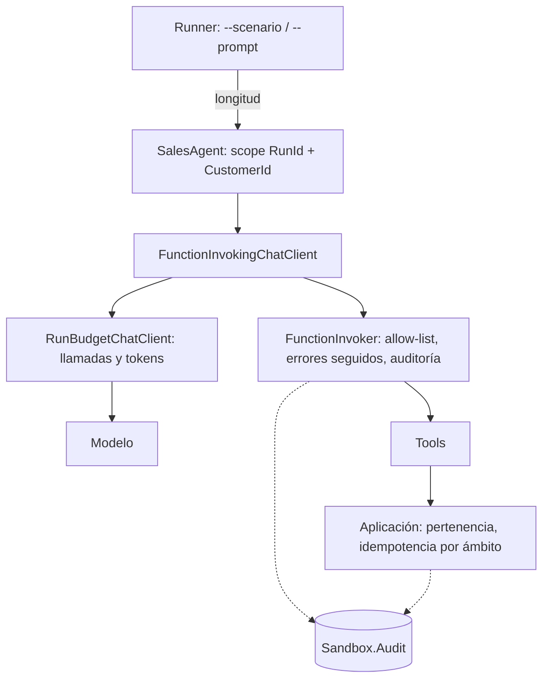
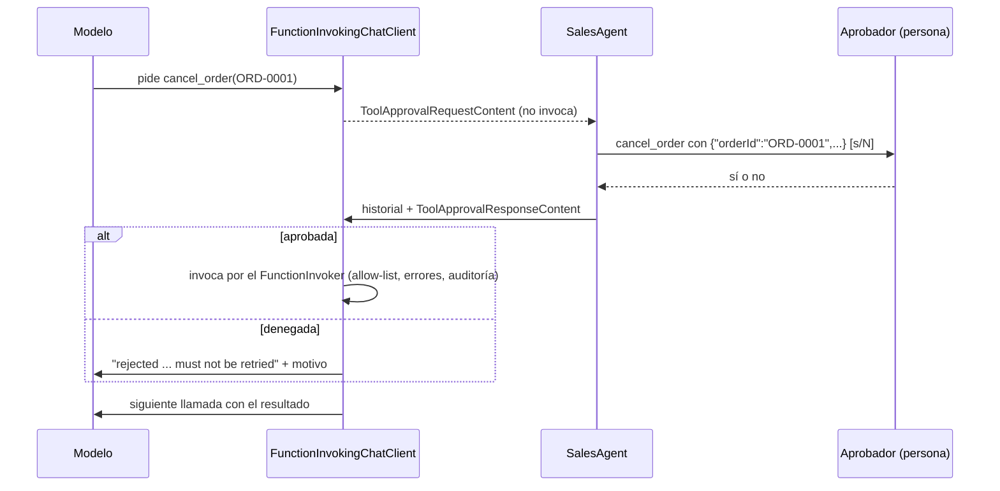

# 5. Guardrails: en qué consisten y qué patrones existen

> **Estado**: documento base, ampliado en la fase 5 con los guardrails implementados (changes `add-agent-guardrails` y `add-tool-approval`). **Verificado**: 2026-10-31 para lo que atañe a Microsoft Learn, 2026-11-02 para las propiedades de `FunctionInvokingChatClient` citadas abajo y 2026-11-05 para la aprobación de tools; lo observado en el spike y en los tests de aprendizaje se marca como tal. Las referencias externas se marcan. La clasificación en capas es **síntesis propia** pensada para este proyecto, no un estándar.

## Qué son

Un **guardrail** es un control que limita lo que un sistema de IA puede recibir, decidir o hacer, para mantenerlo dentro de un comportamiento aceptable. El LLM es **probabilístico y manipulable**; los guardrails son la parte **determinista** que reduce el riesgo.

Regla de oro: **un guardrail de seguridad no puede depender de que el modelo "se porte bien"**. Si el control se escribe solo en el prompt, el modelo lo puede ignorar o ser convencido de saltárselo. Los controles que importan se aplican **en código, fuera del modelo**.

Microsoft lo dice en la documentación de `IChatClient`: las implementaciones no traen salvaguardas por sí mismas y la aplicación debe implementar protecciones frente a *prompt injection*, tamaño de datos y número de mensajes.

## Dónde actúan: capas

### 1. Guardrails de entrada
Controlan lo que llega al modelo.
- Validación y límites de tamaño.
- Detección y enmascarado de datos personales (PII) antes de enviarlos.
- Delimitación del alcance (rechazar temas fuera de dominio).
- Detección de *prompt injection* (clasificadores o heurísticas). **No es infalible**: es una capa más, nunca la única.

### 2. Guardrails de bucle y presupuesto
Controlan cuánto puede trabajar el agente.
- Máximo de iteraciones (en la librería, `MaximumIterationsPerRequest`).
- Máximo de errores consecutivos (`MaximumConsecutiveErrorsPerRequest`).
- Presupuesto de tokens, tiempo y coste por petición.
- *Circuit breaker* si el proveedor falla o si una tool falla repetidamente.

### 3. Guardrails de tool y de acción (los más importantes)
Controlan lo que el agente puede **hacer**. Aquí ocurre el daño real.
- **Lista de permitidas** (allow-list) de tools según contexto.
- **Validación de argumentos** (formato, rango, existencia).
- **Autorización** por usuario, recurso y acción (documento 6).
- **Políticas de negocio deterministas**: importes máximos, horarios, estados permitidos.
- **Confirmación humana** para acciones destructivas o de alto impacto, **ligada a la acción y argumentos exactos**.
- **Limitación de tasa** de acciones de escritura.
- **Vista previa / dry-run** antes de ejecutar.
- **Idempotencia** para que un reintento no duplique el efecto.

### 4. Guardrails de salida
Controlan lo que sale hacia el usuario o hacia otros sistemas.
- Validación contra un esquema (salida estructurada).
- Filtrado de contenido y de datos sensibles que no deban salir.
- Comprobación de que lo afirmado está respaldado por el resultado de las tools (*grounding*).

### 5. Auditoría y observabilidad
No bloquean, pero hacen posible investigar y demostrar.
- Registro estructurado de cada tool: quién, qué, argumentos, decisión, resultado, correlación.
- Trazas y métricas (OpenTelemetry).
- Detección de anomalías y *kill switch*.

## Patrones de diseño relevantes

| Patrón | Idea | Dónde actúa |
|--------|------|-------------|
| **Mínimo privilegio** | El agente solo tiene los permisos de la tarea; lectura y escritura separadas | Identidad y tools |
| **Allow-list de acciones** | Lo no permitido explícitamente se deniega | Tool |
| **Humano en el bucle** | Aprobación explícita de acciones críticas | Tool |
| **Doble verificación determinista** | El dominio revalida todo, aunque el agente ya lo haya comprobado | Dominio |
| **Propone, valida, ejecuta** | El agente propone un plan o acción; un componente determinista lo valida; después se ejecuta | Tool/bucle |
| **Aislamiento de contenido no confiable** | El texto externo (correos, documentos) se trata como datos, nunca como instrucciones, y se evita que dé acceso a acciones sensibles | Arquitectura |
| **Reducir la "trifecta letal"** | Evitar que un mismo agente combine acceso a datos privados, contenido no confiable y capacidad de comunicar hacia fuera | Arquitectura |
| **Fail closed** | Ante duda o error de la política, se bloquea | Todas |
| **Límites duros** | Topes de iteraciones, importes, volumen | Bucle/dominio |

La "trifecta letal" y los patrones de diseño frente a *prompt injection* proceden de literatura externa reciente **(no verificada en esta sesión; se estudiará en la fase 6)**.

## Guardrails deterministas frente a probabilísticos

| Tipo | Ejemplos | Fiabilidad | Uso |
|------|----------|------------|-----|
| **Deterministas** | Allow-list, validación, límites, autorización, políticas de negocio | Alta, reproducible, testeable | **Base de la seguridad** |
| **Probabilísticos** | Clasificadores de inyección o de toxicidad, LLM como juez | Útil pero falible | Capa adicional de defensa en profundidad |

Criterio del proyecto: **lo crítico es determinista**; lo probabilístico complementa.

## Cómo se implementa en este proyecto

El primer change de la fase 5 (`add-agent-guardrails`) implementa los guardrails deterministas del bucle. Cada uno tiene su requisito en la spec `agent-guardrails` y sus tests sin LLM, con un modelo falso con guion.

| Guardrail | Mecanismo | Qué devuelve al bloquear |
|-----------|-----------|--------------------------|
| Límite de llamadas al modelo (`Guardrails:MaxModelCalls`, 10) | Cliente de presupuesto propio entre el bucle y el modelo; corta antes de la llamada N+1 | Motivo de parada `ModelCallLimit` |
| Presupuesto de tokens (`Guardrails:TokenBudget`, 20.000) | El mismo cliente: acumula el uso y no inicia una llamada si se alcanzó | Motivo `TokenBudget` |
| Errores de tool seguidos (`Guardrails:MaxConsecutiveToolErrors`, 3) | Contador en el `FunctionInvoker`, corta con `Terminate` | Motivo `ToolErrorLimit` |
| Allow-list (`Guardrails:AllowedTools`, todas por defecto) | Solo se ofrecen las permitidas; el resto va a `AdditionalTools` para que el `FunctionInvoker` las bloquee | `ToolError` `BLOCKED_BY_POLICY` al modelo |
| Tools inventadas | Se detectan al terminar, comparando las peticiones con lo que vio el `FunctionInvoker` | `UNKNOWN_TOOL` en el resultado y la auditoría |
| Longitud de la petición (2.000 caracteres) | Comprobación antes de llamar al modelo | Código de salida 2 en el Runner |
| Autorización por recurso | La aplicación comprueba la pertenencia ([documento 06](06-autenticacion-y-autorizacion.md), ADR 0005) | `ORDER_NOT_FOUND`, como un pedido inexistente |
| Auditoría | Categoría de registro `Sandbox.Audit`, con *scope* de ejecución y cliente | No bloquea |
| Confirmación humana de `cancel_order` | `ApprovalRequiredAIFunction`: el bucle se pausa, se pregunta a un aprobador (consola o guion) y se reanuda | Si se deniega, no se ejecuta; el resultado registra `CONFIRMATION_DENIED` |
| Reglas de negocio | Servicios de dominio (fase 3) | Error de dominio con código estable |

### Lo que cubren los límites de la librería y lo que no

`FunctionInvokingChatClient` trae límites propios, pero **no bastan con un diseño en el que las tools devuelven errores en lugar de lanzar excepciones**. Esto se vio en un spike y quedó fijado en tests de aprendizaje (`GuardrailLearningTests`), con `Microsoft.Extensions.AI` 10.11.0:

| Qué se probó | Qué pasó | Consecuencia |
|---|---|---|
| `MaximumIterationsPerRequest = N` con un modelo que siempre pide tools | **N+1 llamadas**: al llegar al límite, la librería hace una llamada extra sin tools para forzar una respuesta de texto (observado; la documentación no lo describe) | El límite de llamadas se aplica en un cliente propio, que bloquea justo esa llamada extra |
| `MaximumConsecutiveErrorsPerRequest = 1` con una tool que devuelve un error sin lanzar | No cuenta: el bucle sigue hasta el límite de iteraciones. La documentación lo confirma: el límite cuenta **excepciones** | Contador propio de `ToolError` en el `FunctionInvoker` |
| `context.Terminate = true` en el `FunctionInvoker` | Termina tras esa invocación, sin más llamadas; si la respuesta pedía más tools, **tampoco se ejecutan** | Así corta el límite de errores seguidos |
| El modelo pide una tool que no está en `ChatOptions.Tools` | La librería le responde con su propio texto (`Error: Requested function ... not found.`) y **no pasa por el `FunctionInvoker`** | Sin más, un intento de usar una tool no permitida no quedaría auditado ni respondería con `ToolError` |
| La misma tool en `AdditionalTools` | No se ofrece al modelo, pero si la pide **sí pasa por el `FunctionInvoker`** (la documentación lo describe) | Base de la allow-list: las no permitidas se bloquean con `BLOCKED_BY_POLICY` y se auditan |
| Un cliente intermedio lanza una excepción antes de una llamada | Llega al llamador sin envolver | El cliente de presupuesto corta el bucle con una excepción interna que el agente traduce a un motivo de parada |

Otro efecto observado al escribir los tests: si dos respuestas del modelo traen una petición con el **mismo `CallId`**, la librería da la segunda por respondida y termina el bucle. Con un modelo real no debería ocurrir (cada petición trae un identificador nuevo), pero un modelo falso que reutiliza el mismo paso del guion lo provoca.

### Motivo de parada

Cuando un guardrail para la ejecución, el resultado no es una excepción ni una respuesta vacía, sino un **motivo de parada** (`ModelCallLimit`, `ToolErrorLimit`, `TokenBudget`; `Completed` si el modelo terminó por sí mismo) con una respuesta fija del sistema. Lo que el modelo hubiera escrito hasta entonces queda en el registro. Así:

- el usuario recibe una explicación coherente, no un texto a medias del modelo;
- el resumen conserva lo que sí pasó (llamadas, tools, tokens), útil para depurar;
- el Runner termina con un código propio, el 4, distinto de un éxito y de un error.

### Auditoría correlacionada

Cada invocación de tool deja un evento `ToolInvoked` con la tool, la **decisión** (`Allowed` o `Blocked`), el resultado y la duración, sin argumentos. Además hay eventos para las tools inventadas, las paradas y los accesos denegados de la aplicación. Todos van a la categoría `Sandbox.Audit` y llevan, por un *scope* de registro, el identificador de la ejecución y el cliente. El *scope* sigue el flujo asíncrono, así que también lo llevan los eventos que emite la aplicación, que no sabe nada del agente.

En un sistema real la auditoría iría a un almacén duradero e inalterable, separado del registro operativo; aquí basta con el registro estructurado, que OpenTelemetry podrá exportar en el tercer change de la fase. En la consola, cada línea de una ejecución lleva delante `=> Ejecución <id> del cliente CUST-001`.

### Confirmación humana: pausa y reanudación

`cancel_order` es la única acción irreversible del agente (`Cancelled` es un estado final), así que no se ejecuta sin que una persona la apruebe. El mecanismo es el estándar de `Microsoft.Extensions.AI`: la tool se ofrece envuelta en `ApprovalRequiredAIFunction` y el bucle **no la invoca**, sino que devuelve el control al llamador con la petición exacta. La documentación lo describe así y añade que `ApprovalRequiredAIFunction` solo marca la tool: quien hace cumplir la aprobación es el bucle.

Es el patrón de **pausa y reanudación**, el mismo que necesita una aplicación web o de chat, donde la aprobación llega por otro canal y más tarde. Aquí el aprobador contesta en el momento: es una consola. Lo observado en un spike y fijado en tests de aprendizaje (`ToolApprovalLearningTests`, 10.11.0):

| Qué se probó | Qué pasó |
|---|---|
| El modelo pide la tool marcada | El bucle vuelve tras 1 llamada con un `ToolApprovalRequestContent` que envuelve la petición exacta |
| Se reanuda aprobando | La invocación **pasa por el `FunctionInvoker`**: siguen aplicándose la allow-list, los errores seguidos y la auditoría. El modelo ve un historial normal, sin los contenidos de aprobación |
| Se reanuda denegando | **No pasa por el `FunctionInvoker`**. El modelo recibe un texto de la librería (`Tool call invocation was rejected by the approver and must not be retried.`) con nuestro motivo. Por eso la denegación se registra y se audita en el paso de aprobación (observado, no documentado) |
| Dos peticiones en la misma respuesta, una marcada | **Todo o nada**: las dos piden aprobación (documentado). Las que no requieren confirmación se aprueban en código, sin preguntar a la persona |
| Se ejecuta lo aprobado | Los argumentos de la invocación son los de la petición aprobada |
| Compilar sin silenciar avisos experimentales | Sin avisos: estos tipos no son experimentales en la 10.11.0 |

Decisiones del proyecto (detalle en el `design.md` de `add-tool-approval`):

- **Qué tools**: solo `cancel_order`, fijado en código. Una acción irreversible no debería poder quedarse sin confirmación por un ajuste.
- **Allow-list primero**: si la tool no está permitida, no se envuelve, y se bloquea con `BLOCKED_BY_POLICY` sin preguntar a nadie.
- **Qué ve la persona**: la tool y sus argumentos **en JSON**, por la salida de errores. Los argumentos los escribe el modelo; en JSON, un carácter de control como `ESC` (U+001B), que en una terminal puede iniciar una secuencia que cambie lo que se ve, aparece escapado como `\u001B`.
- ***Fail closed* sin consola**: si la entrada no es interactiva (CI, stdin redirigido), se deniega sin esperar.
- **La denegación cuenta como error seguido**, para que un modelo que insiste no obligue a preguntar una y otra vez.
- **Una denegación no es un fallo**: la ejecución termina con `Completed` y el código 0. Decidió la persona.

Observado contra DeepSeek (2026-11-05, `deepseek-flash`, escenario `cancel-order`):

| Ejecución | Qué hizo el modelo | Decisión | Llamadas | Tokens de entrada |
|---|---|---|---|---|
| Primera descripción de `cancel_order` ("el sistema pide confirmación…") | Consultó el pedido y **preguntó por texto** "¿Confirmas que quieres cancelarlo?", sin pedir `cancel_order` | Ninguna: el pedido quedó sin cancelar | 2 | 2.728 |
| Descripción nueva, sin consola interactiva (2 veces) | Llamó a `cancel_order` | Denegada: "sin consola interactiva"; el modelo no reintentó | 2 | 2.695 |
| Descripción nueva, persona en la consola, `s` | Llamó a `cancel_order` | Aprobada: pedido cancelado | 2 | 2.841 |
| Igual, Intro | Llamó a `cancel_order` | Denegada: el modelo no reintentó y explicó que no se hizo nada | 2 | 2.696 |
| Igual, en `docker compose run` | Llamó a `cancel_order` | Aprobada: compose abre una consola interactiva por defecto | 2 | 2.795 |

La lección más útil es la primera fila: **el modelo tiende a pedir confirmación por su cuenta**, y en una ejecución de un solo turno eso deja la acción sin hacer. La descripción de la tool tuvo que decirle de forma explícita que la llame directamente porque el sistema ya pide la confirmación. El texto de una tool cambia el comportamiento del modelo tanto como el diseño del bucle.

### Observado contra DeepSeek (2026-11-02, `deepseek-flash`)

| Ejecución | Llamadas | Tokens de entrada / salida | Tools | Motivo | Código |
|---|---|---|---|---|---|
| `--scenario happy-order` | 3 | 4.526 / 180 | `list_products`, `place_order` | `Completed` | 0 |
| `--scenario lost-response` | 4 | 6.495 / 311 | `list_products`, `place_order` (`SERVICE_UNAVAILABLE`), `place_order` | `Completed` | 0 |
| `--scenario read-only` | 2 | 1.884 / 126 | `list_products` | `Completed` | 0 |
| Petición que pide expresamente `place_order`, con solo `list_products` y `get_stock` permitidas | 1 | 678 / 87 | ninguna | `Completed` | 0 |
| `--scenario happy-order --Guardrails:TokenBudget=2000` | 2 | 2.755 / 121 | `list_products`, `place_order` | `TokenBudget` | 4 |

Tres lecciones:

- **El modelo no pide lo que no se le ofrece.** En `read-only` explicó que no podía crear el pedido, y ni siquiera insistiendo en el texto llegó a pedir `place_order`. Así que `BLOCKED_BY_POLICY` no se vio con el modelo real: es defensa en profundidad para cuando el modelo conozca la tool por otra vía (memoria, un texto inyectado), y está probada con el modelo falso.
- **Ofrecer menos tools abarata cada llamada.** Con la misma petición, la primera llamada pasa de 1.232 tokens de entrada (seis tools) a 792 (cuatro), porque los esquemas de las tools viajan en cada llamada.
- **Un guardrail puede parar después de una escritura.** Con el presupuesto bajo, `place_order` creó el pedido y la parada llegó justo antes de la respuesta. El primer texto fijo ("No he podido completar tu petición…") daba a entender que no se había hecho nada. Ahora avisa de que lo ya hecho se mantiene y remite al resumen, que lista las tools ejecutadas. En un sistema con estado persistente (aquí cada ejecución empieza con el estado en memoria vacío), repetir la petición con una clave nueva crearía un segundo pedido: por eso importa decir la verdad sobre lo ya hecho. Es razonamiento, no algo observado.

## Errores típicos

- Poner la política solo en el *system prompt*.
- Un único guardrail (por ejemplo, solo un detector de inyección) como defensa.
- Guardrails que lanzan excepciones en lugar de devolver un resultado que el agente pueda interpretar.
- Confirmación humana genérica ("¿continuar?") en lugar de mostrar la acción exacta.
- Pedir la confirmación por texto al modelo ("pregunta al cliente antes de cancelar"): el modelo puede saltárselo, y en una ejecución de un solo turno no hay respuesta posible.
- Mostrar a la persona los argumentos del modelo tal cual en una terminal: un carácter de control puede alterar lo que ve.
- Aprobar con una pregunta que nadie puede contestar (sin consola) y tomar el silencio como un sí.
- No probar los guardrails con ataques realistas.
- Registrar en auditoría datos sensibles en claro.
- Confiar en `MaximumConsecutiveErrorsPerRequest` cuando las tools devuelven errores como datos: solo cuenta excepciones.
- Quitar una tool de las ofrecidas y creer que con eso está bloqueada: si el modelo la pide, la librería responde por su cuenta y nada lo audita.
- Comprobar un atajo (repetición idempotente, caché) antes que la autorización, sin que la clave dependa de quién pide: devuelve resultados ajenos (ADR 0005).
- Contar con que el modelo se callará al llegar a un límite: la librería le pide una respuesta más, y eso también cuesta tokens.
- Un mensaje de parada que da a entender que no se hizo nada, cuando la parada llegó después de una acción que cambió estado.
- Probar una opción de configuración en lugar de su efecto: aquí, el test comprobaba `IncludeScopes` y la consola real no mostraba los *scopes*.

## Referencias

- Aprobación de tools en el bucle: <https://learn.microsoft.com/dotnet/api/microsoft.extensions.ai.functioninvokingchatclient> (observaciones sobre `ApprovalRequiredAIFunction`) y <https://learn.microsoft.com/dotnet/api/microsoft.extensions.ai.approvalrequiredaifunction> (consultados el 2026-11-05)

- Riesgos documentados de `IChatClient`: <https://learn.microsoft.com/dotnet/api/microsoft.extensions.ai.ichatclient>
- Límites del bucle: <https://learn.microsoft.com/dotnet/api/microsoft.extensions.ai.functioninvokingchatclient.maximumiterationsperrequest> y <https://learn.microsoft.com/dotnet/api/microsoft.extensions.ai.functioninvokingchatclient.maximumconsecutiveerrorsperrequest> (consultados el 2026-11-02)
- Tools no ofrecidas y desconocidas: <https://learn.microsoft.com/dotnet/api/microsoft.extensions.ai.functioninvokingchatclient.additionaltools> y <https://learn.microsoft.com/dotnet/api/microsoft.extensions.ai.functioninvokingchatclient.terminateonunknowncalls> (consultados el 2026-11-02)
- Middleware en el pipeline: <https://learn.microsoft.com/dotnet/ai/ichatclient#custom-ichatclient-middleware>
- Mínimo privilegio y aprobaciones: <https://learn.microsoft.com/security/zero-trust/sfi/least-privilege-for-ai-agents>
- Defensa de IA en identidad y acceso: <https://learn.microsoft.com/security/zero-trust/catalog-ai-defense-capabilities/identity-access-least-privilege>
- OWASP Top 10 para aplicaciones LLM y literatura sobre prompt injection: **no verificado**, a estudiar en fase 6.
