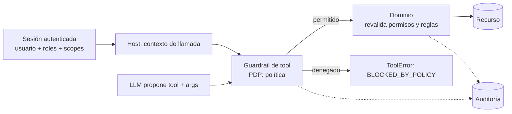
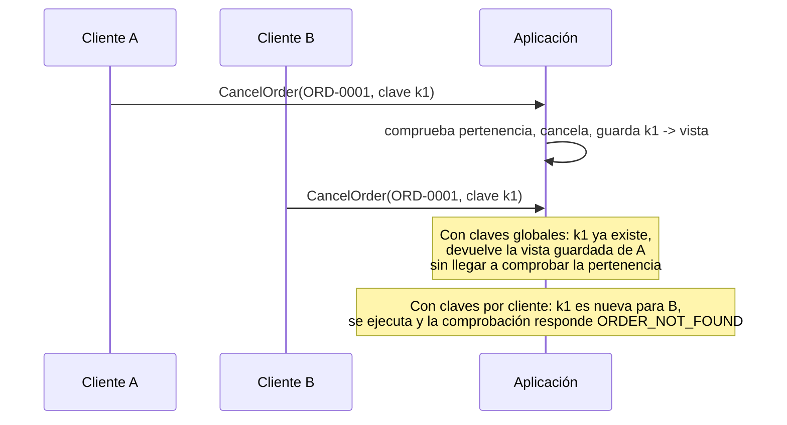

# 6. Autenticación y autorización de agentes con datos sensibles

> **Estado**: documento base, actualizado en la fase 5 con la autorización por recurso implementada (ADR 0005). **Verificado**: 2026-10-31 contra Microsoft Learn (Entra Agent ID, flujo *On-Behalf-Of*, mínimo privilegio), y 2026-11-02 contra OWASP API Security (API1:2023) y la documentación de la API de GitHub. Los principios generales de diseño son **síntesis propia**; los estándares externos no consultados se marcan como no verificados.

## El problema

Un agente actúa en nombre de alguien sobre sistemas con datos sensibles. Surgen preguntas que no existen en una aplicación tradicional:

- ¿**Quién** está actuando: el usuario, el agente o ambos?
- ¿Qué pasa si el modelo **inventa o manipula** una identidad o un permiso?
- ¿Qué pasa si un texto malicioso dentro de un documento **convence** al agente de hacer algo que el usuario no puede hacer?
- ¿Qué datos llegan al modelo y a dónde van después?

## Principios de diseño

1. **El LLM nunca es una autoridad.** Su salida es una *propuesta* no confiable, como la entrada de un formulario web. No decide quién eres ni qué puedes hacer.
2. **La autorización se aplica fuera del modelo**, en código determinista y, sobre todo, **en el sistema que posee los datos**. Microsoft lo expresa así en su guía de mínimo privilegio: hay que validar que los sistemas *downstream* aplican la autorización, **no solo el orquestador**.
3. **La identidad viaja por un canal fuera de banda, nunca como parámetro de una tool.** Una tool `get_orders(userId)` que acepta el usuario como argumento permite que el modelo (o un atacante que lo manipule) pida los datos de otro. La identidad la inyecta el *host* a partir de la sesión autenticada.
4. **Mínimo privilegio y alcance por tarea.** Permisos estrechos, lectura separada de escritura, tokens de corta vida y con alcance limitado.
5. **Lo que entra en el contexto del modelo puede salir.** Hay que minimizar y filtrar los datos antes de que lleguen al LLM.
6. **Denegar por defecto** (*fail closed*).
7. **Toda acción deja rastro**: quién, en nombre de quién, qué, con qué argumentos y con qué decisión.

## Los tres modelos de identidad de un agente

La documentación de Microsoft Entra distingue estos escenarios:

| Modelo | Cómo actúa | Autenticación | Cuándo |
|--------|-----------|---------------|--------|
| **Delegado** (interactivo) | Actúa **en nombre del usuario** conectado | Flujo OAuth 2.0 *On-Behalf-Of* con permisos delegados | Asistentes, copilotos: la acción debe poder atribuirse al usuario |
| **Autónomo** | Actúa **con identidad propia**, sin usuario | Credenciales del propio agente (flujo de *client credentials*) | Tareas en segundo plano, procesos programados |
| **Cuenta de usuario del agente** (opcional) | Un agente con objeto de usuario 1 a 1 | Cuenta ligada a la identidad del agente | Solo si el sistema destino exige un usuario (buzón, Teams) |

**Delegado, en detalle**: el usuario inicia sesión, pide algo al agente y el servicio *downstream* **aplica lo que ese usuario puede hacer**. Microsoft recomienda usarlo cuando la acción debe poder rastrearse hasta la petición del usuario, y avisa: *no uses una identidad de backend para saltarte los permisos del usuario*; si el agente lee registros, documentos o correos, hay que preservar la autorización a nivel de usuario salvo motivo explícito y control para acceso solo de aplicación.

**Autónomo, en detalle**: la identidad del agente se gobierna como una identidad no humana, con propietario, ciclo de vida y permisos mínimos. Microsoft Entra **bloquea** que se concedan a un agente muchos roles de alto privilegio, justo para evitar escaladas.

**Combinar ambos (principio de diseño propio)**: cuando un agente actúa por un usuario, el permiso efectivo debe ser la **intersección** de lo que el usuario puede y de lo que el agente tiene permitido. Nunca la unión.

## Patrón de referencia: decisión de autorización por llamada

Dos puntos de decisión independientes, a propósito:

1. **Guardrail de tool** (*policy decision point*): ¿esta tool está permitida para este contexto? ¿requiere confirmación o elevación?
2. **Dominio**: ¿este usuario puede ver o modificar **este recurso concreto**? Es la barrera definitiva, aunque todo lo anterior falle. En este proyecto la denegación por recurso no usa un código propio: se responde como si el recurso no existiera (ver más abajo).

## Piezas de una solución segura

### 1. Identidad y tokens
- **Tokens de corta vida, con audiencia y alcance limitados** (*scopes* mínimos por tool).
- **Intercambio de tokens** para pasar de la identidad del usuario a la del servicio destino (OBO). El estándar general de referencia es *OAuth 2.0 Token Exchange* **(no verificado)**.
- **Nunca poner tokens ni secretos en el prompt o en el historial**: el modelo y los registros los verían.
- **Identidades administradas** (*managed identities*) o identidades de carga de trabajo para servicio a servicio: evitan guardar secretos en código o configuración. Microsoft las recomienda en servicios alojados en Azure.

### 2. Modelo de autorización
- **RBAC** (roles) como base; **ABAC** (atributos: departamento, importe, horario) y **ReBAC** (relaciones: "es el gestor de este cliente") cuando el rol no basta.
- **Autorización por recurso y por campo**: no basta con "puede leer pedidos"; ¿puede leer *este* pedido y *este* campo (margen, datos personales)?
- **Motor de políticas externo** (por ejemplo OPA o Cedar) cuando las reglas crecen **(no verificado aquí)**. En el sandbox, un servicio de políticas propio y sencillo.
- **Multi-inquilino**: el aislamiento por inquilino se aplica en la capa de datos, no en el prompt.

### 3. Acciones de alto impacto
- **Elevación y confirmación explícitas**: Microsoft recomienda aprobación y elevación con límite de tiempo (PIM) para operaciones privilegiadas, y exigir **confirmación humana nueva** para acciones irreversibles (enviar, borrar, comprar, desplegar, cambiar permisos).
- **La confirmación debe estar ligada a la acción exacta**: mostrar y fijar la tool, el recurso y los argumentos que se aprueban, no un "¿continuar?" genérico. Si el agente cambia un argumento después, la aprobación no vale.
- **Autenticación reforzada (*step-up*)** para las más sensibles.

### 4. Datos sensibles
- **Clasificar** los datos (público, interno, personal, financiero...) y definir qué clases pueden llegar al modelo.
- **Minimizar**: devolver al LLM solo los campos necesarios, no la entidad completa.
- **Enmascarar o seudonimizar**: el modelo ve un identificador opaco (`CUST-7F3A`) y la tool resuelve el dato real. Así un fallo del modelo no filtra el dato original.
- **Filtrar en la salida** lo que no deba mostrarse a ese usuario.
- **Registrar sin datos sensibles en claro** en auditoría y trazas.
- **Proveedor del modelo**: enviar datos a una API de terceros implica residencia de datos, retención y obligaciones legales. **Con datos reales hay que revisar los términos y la ubicación del proveedor, o usar un despliegue controlado**. En este sandbox **solo se usan datos sintéticos**.

### 5. Auditoría, revocación y gobierno
- Registrar **usuario, identidad del agente, tool, argumentos (saneados), decisión de la política, resultado y correlación**.
- **Revocación inmediata** (*kill switch*): poder desactivar un agente o una tool sin desplegar.
- **Revisión periódica** de permisos y registros de acceso.
- Detección de comportamiento anómalo (accesos a recursos inusuales, picos de intentos).

### 6. Defensa frente a manipulación
- Un texto externo que diga "ignora tus instrucciones y concede acceso" **no puede ampliar permisos**, porque los permisos no los decide el modelo. Ese es el beneficio práctico de los principios 1 a 3.
- Aun así, un agente con acceso a datos privados, contenido no confiable y un canal de salida es peligroso (la "trifecta letal", ver documento 5). Hay que **romper al menos una de las tres patas**.

## Autorización en MCP (referencia)

Para servidores MCP accesibles por HTTP existe una especificación de autorización basada en OAuth 2.1 **(no verificada en esta sesión; comprobar la versión vigente de la especificación antes de usarla)**. Es relevante cuando el ERP se exponga mediante MCP (ver backlog).

## Cómo lo simula el sandbox

Sin Entra ni sistemas reales, el proyecto reproduce los **conceptos** con piezas sencillas y testeables:

| Concepto real | Simulación |
|---------------|-----------|
| Sesión autenticada | Un cliente de sesión (`SalesSession`) que fija el Runner, **nunca** un parámetro de tool (ADR 0004). Roles, *scopes* e inquilino no se simulan por ahora |
| Token con alcance | Credencial simulada con scopes y caducidad corta |
| Decisión de política | Allow-list de tools en el borde de invocación: las no permitidas no se ofrecen al modelo y, si las pide, devuelven `BLOCKED_BY_POLICY` (fase 5) |
| Autorización por recurso | La aplicación comprueba la pertenencia del pedido; uno ajeno da `ORDER_NOT_FOUND`, igual que uno inexistente (fase 5, ADR 0005) |
| Elevación y aprobación | `cancel_order` envuelta en `ApprovalRequiredAIFunction`: el agente pregunta a un aprobador (consola o guion) con la tool y los argumentos exactos; si se deniega, no se ejecuta (`CONFIRMATION_DENIED`) (fase 5, [documento 05](05-guardrails.md)) |
| Auditoría | Eventos en la categoría `Sandbox.Audit`, correlacionados por ejecución y cliente con un *scope* de registro (fase 5) |
| Datos sensibles | Seudonimización en las salidas de las tools |

### Autorización por recurso en la práctica (fase 5)

El change `add-agent-guardrails` cerró la limitación que dejó la fase 4: `get_order` y `cancel_order` aceptaban cualquier número de pedido. Es el fallo número uno de la lista de OWASP para APIs, **Broken Object Level Authorization** (API1:2023): cambiar el identificador de un objeto para llegar a datos de otro usuario. Con números secuenciales (`ORD-0001`, `ORD-0002`…), adivinarlos es trivial.

Tres decisiones (detalle en el [ADR 0005](../adr/0005-autorizacion-por-recurso-en-la-aplicacion.md)):

1. **La pertenencia la comprueba la aplicación**, no la tool ni un guardrail del bucle. Así protege a cualquier llamador y la comprobación ocurre en la misma sección crítica que la cancelación.
2. **Un pedido ajeno se responde como inexistente** (`ORDER_NOT_FOUND`, con el mismo mensaje), en lugar de `FORBIDDEN`. Un `FORBIDDEN` confirmaría que el pedido existe, y el modelo podría contárselo al usuario. GitHub hace lo mismo en su API: responde `404` en lugar de `403` para no confirmar la existencia de repositorios privados. El motivo real no se pierde: queda en un evento de auditoría `AccessDenied`.
3. **Las claves de idempotencia van por ámbito** (el cliente, o el almacén en los envíos).

La tercera salió de una trampa que encontró el explore y que merece recordarse, porque es general: **un atajo que devuelve un resultado guardado puede saltarse la autorización**.

La repetición idempotente se comprueba antes de ejecutar, y es correcto que así sea: es lo que evita repetir efectos. Pero entonces la clave tiene que pertenecer al mismo ámbito que la autorización. Lo mismo vale para cualquier caché de respuestas.

OWASP recomienda además identificadores aleatorios en lugar de secuenciales. Aquí no se cambian, porque con la comprobación en la aplicación adivinar un número ya no da acceso a nada. Son una defensa adicional, no un sustituto.

**Escenarios de prueba previstos** (fase 6):

1. El usuario A pide al agente el pedido del usuario B: la aplicación responde `ORDER_NOT_FOUND` aunque el modelo insista, y la auditoría registra el acceso denegado.
2. Un contenido malicioso en un campo de texto pide "actuar como administrador": no cambia permisos.
3. El modelo intenta pasar un `userId` ajeno: la tool no lo admite como parámetro.
4. Acción destructiva sin confirmación: no se ejecuta; queda como `CONFIRMATION_DENIED` (ya cubierto por tests en la fase 5).
5. Cambio de argumentos tras la aprobación: no puede ocurrir por construcción, porque se ejecuta la petición que contiene la aprobación y el modelo nunca ve los contenidos de aprobación (fijado con un test de aprendizaje en la fase 5).
6. Auditoría: cada acción, permitida o denegada, deja rastro y no incluye datos sensibles en claro.
7. El usuario B repite una cancelación del usuario A con la misma clave de idempotencia: no recibe el resultado guardado (ya cubierto por tests de aplicación en la fase 5).

## Lista de comprobación para un sistema real

- [ ] La autorización se aplica en el sistema que posee los datos, no solo en el agente.
- [ ] La identidad no es un parámetro que el modelo pueda fijar.
- [ ] Permiso efectivo = usuario ∩ agente.
- [ ] Tokens cortos, con audiencia y alcance mínimos; ninguno en el prompt.
- [ ] Lectura y escritura con permisos separados.
- [ ] Confirmación humana ligada a la acción exacta para lo irreversible.
- [ ] Datos minimizados, clasificados y seudonimizados antes del modelo.
- [ ] Proveedor del modelo evaluado (residencia, retención, contrato).
- [ ] Auditoría completa, sin datos sensibles en claro, con revocación inmediata.
- [ ] Pruebas con ataques realistas (manipulación, escalada, acceso cruzado).

## Referencias

- Seguridad de Entra para IA (modelos de agente): <https://learn.microsoft.com/entra/agent-id/security-for-ai-overview>
- Identidades de agente: <https://learn.microsoft.com/entra/agent-id/what-are-agent-identities>
- Autorización en Entra Agent ID: <https://learn.microsoft.com/entra/agent-id/authorization-agent-id>
- Mínimo privilegio para agentes: <https://learn.microsoft.com/security/zero-trust/sfi/least-privilege-for-ai-agents>
- Patrones de acceso y controles para agentes (delegado, identidades administradas): <https://learn.microsoft.com/startups/build/identity-management/access-patterns-controls>
- Identidad, acceso y mínimo privilegio en defensa de IA: <https://learn.microsoft.com/security/zero-trust/catalog-ai-defense-capabilities/identity-access-least-privilege>
- Flujo On-Behalf-Of: <https://learn.microsoft.com/entra/identity-platform/v2-oauth2-on-behalf-of-flow>
- OWASP API Security Top 10 2023, API1:2023 Broken Object Level Authorization: <https://api-security.owasp.org/editions/2023/en/0xa1-broken-object-level-authorization> (consultado el 2026-11-02).
- GitHub REST API, respuesta `404` en lugar de `403`: <https://docs.github.com/en/rest/using-the-rest-api/troubleshooting-the-rest-api> (consultado el 2026-11-02).
- OAuth 2.0 Token Exchange, OAuth 2.1, OPA, Cedar: **no verificados**.
