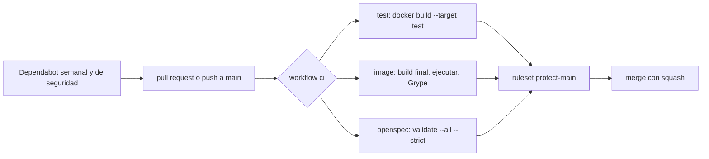

# 9. Integración continua y cadena de suministro

> **Estado**: creado con el change `add-ci-pipeline` (fase 1). Describe la CI implementada, la configuración de seguridad del repositorio en GitHub y Dependabot. Tras el merge se añadió lo observado en `main`: la CI en el push, la primera ejecución de Dependabot y la primera medición. El primer PR de Dependabot sigue pendiente. **Verificado**: 2026-10-31 contra GitHub Docs, la documentación de Docker, los `action.yml` de las acciones y con ejecuciones reales en el PR #13. Lo que viene de fuentes secundarias o no se ha podido comprobar se marca **(no verificado)**.

## Qué es y por qué importa aquí

La **integración continua** (CI) ejecuta de forma automática las comprobaciones de un cambio cada vez que se propone (un pull request) o se integra (un push a `main`). Sirve para que la definición de terminado deje de depender de que alguien se acuerde de ejecutarla.

En este proyecto tiene tres motivos concretos:

| Motivo | Qué aporta aquí |
|---|---|
| **El equipo de desarrollo es pequeño** | El build en contenedor deja la Surface Go 2 con menos de 1 GB libre (documento 07). Los runners de GitHub no consumen RAM local |
| **El repositorio es público** | Cualquiera puede abrir un PR. La CI debe ejecutarlo sin exponer nada |
| **Todo está fijado** | Imágenes por digest, paquetes con versión exacta, acciones por SHA. Fijar da reproducibilidad, pero congela también las vulnerabilidades. Alguien tiene que avisar de que hay versiones nuevas |

La **cadena de suministro** es todo lo que no escribimos nosotros pero se ejecuta al construir o al ejecutar: imágenes base, paquetes NuGet, acciones de GitHub, la CLI de OpenSpec, el escáner. Un ataque a cualquiera de esas piezas es un ataque al proyecto.

## Cómo está implementado



### El workflow `ci`

Fichero: [`.github/workflows/ci.yml`](../../.github/workflows/ci.yml). Tres jobs en paralelo, sin dependencias entre ellos, para que un fallo no oculte el resultado de los otros:

| Job (= nombre del check) | Qué hace | Tiempo en frío / con caché |
|---|---|---|
| `test` | `docker build --target test` sobre el mismo `Dockerfile` que en local | 51 s / 14 s |
| `image` | Construye la imagen final, la ejecuta una vez con las restricciones del `runner` de compose y la escanea con Grype. Sin clave, la ejecución debe terminar con el código 2 (configuración inválida) y nombrar `DeepSeek:ApiKey` (desde la fase 2; ver [documento 10](10-configuracion-y-secretos-en-net.md)) | 2 min 20 s / 1 min 36 s |
| `openspec` | `openspec validate --all --strict` con la CLI fijada en [`tools/openspec/Dockerfile`](../../tools/openspec/Dockerfile) | 13 s / 14 s |

Los tiempos son de una sola ejecución de cada tipo en el PR #13 (2026-10-31). "Con caché" significa sin cambios de código: en `test`, todos los pasos salieron `CACHED`, también el de los tests.

Detalles de diseño que conviene entender:

- **Sin filtros de ruta.** Un PR que solo cambia Markdown también ejecuta los tres jobs. Más abajo se explica por qué.
- **Runner `ubuntu-24.04`**, no `ubuntu-latest`: lo mismo que no usar `latest` en una imagen.
- **`concurrency` con `cancel-in-progress` solo en PRs**: un push nuevo cancela la ejecución anterior del mismo PR. Se observó al revertir las pruebas negativas: la ejecución de `2420464` quedó `cancelled` al llegar `d54d575`.
- **`timeout-minutes`** en cada job: sin él, un bloqueo consume hasta 6 horas de runner.
- **Caché de BuildKit en GitHub Actions** (`type=gha`, `mode=max`), con un `scope` por job. Se explica más abajo.

La imagen de herramientas de OpenSpec existe por dos motivos:
- fija Node (el del runner cambia con cada imagen);
- Dependabot actualiza su digest, cosa que no haría si la imagen se usara con `docker run` dentro del YAML (lo revisa el ecosistema `docker`, que lee `Dockerfile`).

La versión de la CLI se sube a mano, a la vez que se ejecuta `openspec update` y se regeneran los skills. Así la CI valida con la misma versión que generó los skills.

**Telemetría de OpenSpec (observado)**: la CLI 1.16.0 imprime "OpenSpec collects anonymous usage stats. Opt out: OPENSPEC_TELEMETRY=0…". La imagen define `OPENSPEC_TELEMETRY=0` y, además, en la CI se ejecuta con `--network none`. Para usarla en local:

```bash
docker build -t openspec-cli tools/openspec
docker run --rm --network none -v "$PWD:/repo:ro" openspec-cli validate --all --strict
```

### Permisos: el `GITHUB_TOKEN`

Cada job recibe un token, `GITHUB_TOKEN`, con los permisos que declare el workflow. Aquí:

```yaml
permissions:
  contents: read
```

**Observado**: la sección "GITHUB_TOKEN Permissions" del registro de cada job muestra solo `Contents: read` y `Metadata: read`. Con eso basta para todo lo que hace la CI, incluida la caché de BuildKit, que usa el token interno del runner (`ACTIONS_RUNTIME_TOKEN`) y no el `GITHUB_TOKEN`.

Además, `actions/checkout` usa `persist-credentials: false`, para que el token no quede escrito en `.git/config` al alcance de los pasos siguientes.

Si un job necesitara más (por ejemplo, `security-events: write` para subir resultados a *code scanning*), se declara **en ese job** y con su motivo, nunca en el nivel del workflow.

### `pull_request` frente a `pull_request_target`

| Evento | Código que ejecuta | Token y secretos en un PR de un fork |
|---|---|---|
| `pull_request` | El del PR | Token de solo lectura, sin secretos |
| `pull_request_target` | El de la rama base | Token con los permisos del repositorio y acceso a secretos |

`pull_request_target` existe para tareas que necesitan escribir en el repositorio (etiquetar un PR, comentar). Si además hace *checkout* del código del PR y lo ejecuta, cualquiera puede robar los secretos con un PR. Es la vía clásica de ataque a la CI de proyectos públicos. Aquí solo se usa `pull_request` y no hay ningún secreto. Que un PR de un fork se ejecute sin secretos ni permisos de escritura es lo que dice la documentación; aquí no hay ningún fork con el que probarlo **(no verificado en este repositorio)**.

### Acciones fijadas por SHA

Una acción se referencia por etiqueta (`actions/checkout@v7.0.1`) o por el SHA de un commit (`actions/checkout@3d3c42e5…`). **Una etiqueta se puede mover** a otro commit; un SHA no.

En **marzo de 2026**, según varias fuentes secundarias, alguien forzó casi todas las etiquetas de versión de `aquasecurity/trivy-action` para que apuntaran a commits con un programa que robaba credenciales del runner. Quien usaba `@v0.x` ejecutó el código malicioso; quien fijaba un SHA, no **(no verificado en el aviso oficial de Aqua Security)**.

Aquí:

- Todas las acciones se fijan con el SHA completo y la versión en un comentario:

  ```yaml
  - uses: actions/checkout@3d3c42e5aac5ba805825da76410c181273ba90b1 # v7.0.1
  ```
- El SHA de cada etiqueta se obtuvo de la API de GitHub. Para una etiqueta anotada, hay que resolver el objeto etiqueta hasta llegar al commit:

  ```bash
  gh api repos/actions/checkout/git/ref/tags/v7.0.1   # object.type = commit o tag
  ```
- **El repositorio exige SHA** (`sha_pinning_required: true`). **Observado**: un workflow temporal con `actions/checkout@v7.0.1` falla antes de empezar, con la anotación "The action actions/checkout@v7.0.1 is not allowed in Kash0321/agentic-ai-sandbox because all actions must be pinned to a full-length commit SHA".
- Las cuatro acciones usadas son de tipo `node24` y no llaman a otras acciones. Según una fuente secundaria, la exigencia también se aplica a las acciones anidadas dentro de una acción compuesta, que podrían romperse si usan etiquetas **(no verificado)**.

Fijar por SHA no protege de una acción maliciosa **desde su origen**: solo garantiza que se ejecuta exactamente el código revisado. Por eso también importa **qué** acciones se usan. Aquí son las mínimas, de organizaciones conocidas.

### Checks obligatorios en el ruleset

El ruleset `protect-main` ([`.github/rulesets/protect-main.json`](../../.github/rulesets/protect-main.json)) exige que `test`, `image` y `openspec` terminen en verde antes de fusionar:

```json
{
  "type": "required_status_checks",
  "parameters": {
    "strict_required_status_checks_policy": false,
    "required_status_checks": [
      { "context": "test", "integration_id": 15368 },
      { "context": "image", "integration_id": 15368 },
      { "context": "openspec", "integration_id": 15368 }
    ]
  }
}
```

- **`context`** es el nombre del check, que en GitHub Actions es el identificador del job. Renombrar un job sin tocar el ruleset deja `main` bloqueada.
- **`integration_id`** liga el check a una aplicación concreta. 15368 se leyó del campo `app.id` de los *check runs* reales del PR (`app.slug: github-actions`), no de la documentación. Sin él, cualquier integración con permiso para publicar checks podría publicar uno llamado `test` en verde.
- **`strict_required_status_checks_policy: false`**: no exige que la rama esté al día con `main`. Con *squash* y una sola persona fusionando, aporta poco.

**Observado en el PR #13**:
- los tres checks aparecen con `isRequired: true` (consulta GraphQL `isRequired(pullRequestNumber:)`);
- con `image` en rojo, el PR queda en `mergeStateStatus: BLOCKED`;
- al volver a verde pasa a `CLEAN`, aunque siga en borrador. El bloqueo lo causa el check obligatorio.

**La trampa de los filtros de ruta**: si un workflow obligatorio tiene `paths:` o `branches:` y no se ejecuta, su check no se publica, queda en "Pending" y **bloquea el merge para siempre**. En cambio, un job saltado por una condición `if:` cuenta como correcto. Por eso este workflow no filtra nada (GitHub Docs, *Troubleshooting required status checks*).

**Orden de activación** (el que se siguió): primero los workflows en un PR, para ver los nombres reales de los checks; después la exigencia de SHA; y solo entonces el ruleset. Al revés, `main` podría quedar exigiendo checks que nunca se publican.

### Escaneo de vulnerabilidades de la imagen

Un escáner lista los paquetes de la imagen (Grype usa Syft para ello) y los cruza con una base de datos de vulnerabilidades conocidas (CVE y avisos de las distribuciones).

**El resultado no es determinista**: la base de datos se descarga en cada ejecución y cambia cada día. El mismo commit puede pasar hoy y fallar mañana porque se ha publicado un aviso. Es justo lo que se busca, porque fijar el digest congela los parches.

La política está en el [ADR 0002](../adr/0002-checks-obligatorios-y-politica-de-vulnerabilidades.md): el check falla solo con severidad **alta o crítica y arreglo disponible**. Se implementa en dos pasos con la misma versión de Grype (v0.121.0):

1. **Informe** (`fail-build: false`, `output-format: table`): muestra todas las vulnerabilidades en el registro.
2. **Control** (`severity-cutoff: high`, `only-fixed: true`, `fail-build: true`).

¿Por qué dos pasos? Según la documentación de la acción, `only-fixed` **solo informa** de las vulnerabilidades con arreglo. Con un solo paso, las que no tienen arreglo desaparecerían del registro. Lo descubrimos al implementar, leyendo el `action.yml`.

**Observado el 2026-10-31**:
- Grype detecta 11 paquetes en la imagen final y 7 vulnerabilidades en `libc6` 2.39-0ubuntu8.9: 6 medias y 1 *negligible* marcada "won't fix", **ninguna con arreglo**. El control pasa.
- Con un umbral temporal `low` y sin `only-fixed`, el mismo escaneo falla ("Failed minimum severity level"). El mecanismo de bloqueo funciona.
- El caso exacto "alta con arreglo" no se ha podido reproducir porque la imagen no tiene ninguna **(no verificado con datos reales)**.
- Descargar la base de datos tarda unos 80 s. Con `cache-db: true`, el segundo paso la restaura de la caché del mismo job (`Cache hit for: grype-db-v0.121.0`).

### Caché de BuildKit en la CI

`docker/build-push-action` con `cache-from`/`cache-to: type=gha` guarda las capas en la caché de GitHub Actions.

- **`mode=max`** exporta también las capas de las etapas intermedias (`restore`, `build`), que son las caras.
- **Un `scope` por job**: según la documentación de Docker, los builds que comparten `scope` se sobrescriben y solo queda la caché del último. Con dos jobs en paralelo, cada uno perdería la del otro.
- **Aislamiento**: un workflow solo accede a la caché de su rama, de la rama base y de la rama por defecto (documentación de Docker). Un PR no puede escribir la caché que lee `main` **(no verificado en este repositorio)**.
- **Cachear la etapa `test`** hace que, sin cambios en las entradas, los tests no se vuelvan a ejecutar, igual que en local. Se acepta porque son deterministas.

También se observó que `docker/build-push-action` sube un artefacto con el registro del build (`.dockerbuild`, unos 37 KB). Su contenido no se ha revisado.

### Dependabot

Fichero: [`.github/dependabot.yml`](../../.github/dependabot.yml).

| Tipo | Qué hace | Configuración aquí |
|---|---|---|
| **Actualizaciones de versión** | PRs con versiones nuevas de lo que esté fijado | Semanales (lunes, 06:00, `Europe/Madrid`), un PR por ecosistema (`groups`), periodo de espera por defecto de 3 días |
| **Alertas** | Avisos de vulnerabilidades conocidas en las dependencias | Activadas en el repositorio |
| **Actualizaciones de seguridad** | PRs que corrigen una vulnerabilidad, sin esperar a la revisión semanal | Activadas; no pertenecen a los grupos |

Ecosistemas: `nuget` (`Directory.Packages.props`), `docker` (`/` y `/tools/openspec`) y `github-actions`.

GitHub **no** valida `dependabot.yml` en el PR: no apareció ningún check para ello. Antes del merge solo se pudo validar en local contra el esquema público de SchemaStore, que no es la fuente oficial de GitHub.

**Observado tras el merge (2026-10-31)**: Dependabot se ejecutó solo al llegar `dependabot.yml` a `main`, una vez por ecosistema (workflow "Dependabot Updates", evento `dynamic`). Las tres ejecuciones terminaron bien, lo que confirma que GitHub acepta la configuración. Ninguna abrió PR porque todo estaba en la última versión. Del registro de cada ejecución:

| Ecosistema | Qué reconoció | Resultado |
|---|---|---|
| `docker` | Las imágenes fijadas con `etiqueta@digest`, identificadas **por su etiqueta**: `dotnet/sdk 10.0.403-noble` y `dotnet/runtime 10.0.14-noble-chiseled` en `/`, y `node 26.13.0-alpine` en `/tools/openspec` | "No update needed" |
| `github-actions` | Las cuatro acciones fijadas por SHA, identificadas **por la versión del comentario o de la etiqueta que apunta a ese SHA**: `actions/checkout 7.0.1`, `docker/setup-buildx-action 4.4.1`, `docker/build-push-action 7.4.0` y `anchore/scan-action 7.4.2` | "No update needed" |
| `nuget` | `xunit.v3` 4.0.2 en los proyectos de tests, con la versión en `Directory.Packages.props` (gestión centralizada) | "No updatable version found" |

Queda pendiente **cómo reescribe** las referencias cuando sí hay versión nueva: si cambia etiqueta y digest a la vez, si actualiza el SHA y el comentario, y si edita `Directory.Packages.props` en lugar de los `.csproj` **(no verificado; pendiente de su primer PR)**. Cuál de las dos cosas (el comentario o la etiqueta que apunta al SHA) usa para identificar la versión de una acción tampoco se puede saber por el registro.

### Configuración que no vive en ficheros

Algunos ajustes de seguridad están en GitHub, no en el repositorio. Se comprueban así:

```bash
gh api repos/{owner}/{repo}/actions/permissions          # sha_pinning_required: true
gh api repos/{owner}/{repo}/actions/permissions/workflow # default_workflow_permissions: read
gh api repos/{owner}/{repo}/vulnerability-alerts -i      # 204 = activadas, 404 = desactivadas
gh api repos/{owner}/{repo}/automated-security-fixes     # enabled: true
gh api repos/{owner}/{repo}/rulesets/26267641            # comparar con protect-main.json
```

Al comparar el ruleset con el JSON, el servidor añade valores por defecto que el fichero no lleva (`required_reviewers: []`, `do_not_enforce_on_create: false`, `require_extra_approval_for_unattributed_changes: true`). No son diferencias reales.

## Medición nativo frente a contenedor en el runner

El workflow manual [`measure.yml`](../../.github/workflows/measure.yml) mide en un mismo runner los escenarios de la tabla del documento 07. **Solo se puede lanzar cuando está en `main`**: desde la rama del change, `gh workflow run measure.yml --ref <rama>` devolvió `HTTP 404: workflow measure.yml not found on the default branch`. Tras el merge:

```bash
gh workflow run measure.yml
gh run watch
```

La primera ejecución (2026-10-31, run 41227837734) tardó 1 min 12 s. Tras cambiar código, el contenedor tarda ×1,4 lo que tarda el nativo. Resultados y conclusión en el [documento 07](07-contenedores-en-sistemas-agenticos.md#medición-en-un-runner-de-github).

**Lección**: la primera versión solo escribía la tabla en el resumen de la ejecución (`$GITHUB_STEP_SUMMARY`). Ni la API ni la página pública sin sesión iniciada lo muestran, así que hubo que copiarla a mano desde el navegador. Ahora también se imprime en el registro del job, que sí se puede leer con `gh run view --log`.

## Lo observado tras el merge

- **Push a `main`**: la CI se ejecutó con el evento `push` sobre el commit del merge (run 41227735087), en verde.
- **Dependabot**: ver su sección; reconoce los tres formatos de fijación.
- **Workflows borrados**: `gh workflow list --all` sigue mostrando `tmp-sha-check`, el workflow temporal de la prueba de SHA, aunque su fichero ya no existe. GitHub conserva el registro de los workflows que se han ejecutado alguna vez.

## Alternativas y trade-offs

| Decisión | Alternativa | Por qué no |
|---|---|---|
| Grype | Trivy | Mismo modelo; su acción sufrió el ataque de marzo de 2026 |
| Grype | Docker Scout | Exige credenciales de Docker Hub: un secreto en la CI |
| Bloquear high/critical con arreglo | Solo informar (SARIF) | No protege `main`; necesita `security-events: write` |
| Tres jobs | Un único job | Más rápido, pero un solo check no dice qué falló |
| Imagen propia para OpenSpec | `package.json` + `npm ci` | Dependabot subiría la CLI sin regenerar los skills |
| Sin filtros de ruta | `paths-ignore: ['**.md']` | El check obligatorio quedaría "Pending" en los PRs de documentación |

## Errores típicos

- Poner un filtro `paths:` en un workflow cuyo check es obligatorio.
- Fijar acciones por etiqueta (`@v4`) o, peor, por rama (`@main`).
- Dar `permissions: write-all` "para que funcione", o declarar permisos de escritura en el nivel del workflow.
- Usar `pull_request_target` con *checkout* del código del PR.
- Pasar secretos a un build de Docker con `--build-arg`: quedan en el historial de la imagen.
- Exigir checks en el ruleset antes de que se hayan publicado alguna vez: no se ve el nombre real y es fácil escribirlo mal.
- Bloquear el build por cualquier CVE: sin arreglo publicado no hay salida, y el equipo aprende a ignorar el check.
- Revertir una prueba negativa con `git revert` cuando el commit temporal incluía otros cambios legítimos (pasó aquí; se revirtió a mano).
- En PowerShell, `git show <rev>:<fichero> | Set-Content -NoNewline` une todas las líneas en una. Para restaurar un fichero desde un commit, `git checkout <rev> -- <fichero>` (pasó aquí).

## Referencias

- Troubleshooting required status checks: <https://docs.github.com/en/pull-requests/collaborating-with-pull-requests/collaborating-on-repositories-with-code-quality-features/troubleshooting-required-status-checks>
- Permisos de Actions por API (`sha_pinning_required`): <https://docs.github.com/en/rest/actions/permissions>
- Opciones de `dependabot.yml`: <https://docs.github.com/en/code-security/dependabot/working-with-dependabot/dependabot-options-reference>
- Ecosistemas de Dependabot: <https://docs.github.com/en/code-security/dependabot/ecosystems-supported-by-dependabot/supported-ecosystems-and-repositories>
- Caché `gha` de BuildKit: <https://docs.docker.com/build/cache/backends/gha/>
- Acción de Grype: <https://github.com/anchore/scan-action>
- Imagen del runner `ubuntu-24.04`: <https://github.com/actions/runner-images/blob/main/images/ubuntu/Ubuntu2404-Readme.md>
- Ataque a `trivy-action` (fuentes secundarias): <https://phoenix.security/trivy-supply-chain-attack-team-pcp/>, <https://feed.craftedsignal.io/briefs/2026-03-trivy-action-compromise/>
- Esquema de `dependabot.yml` (no oficial): <https://json.schemastore.org/dependabot-2.0.json>
- Decisión: [ADR 0002](../adr/0002-checks-obligatorios-y-politica-de-vulnerabilidades.md). Contenedores: [documento 07](07-contenedores-en-sistemas-agenticos.md).
