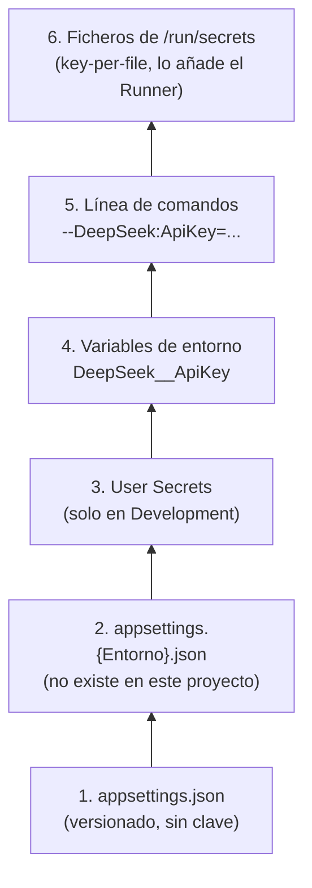

# 10. Configuración y secretos en una consola .NET

> **Estado**: creado con el change `add-deepseek-chat-client` (fase 2); ampliado con `add-order-domain` (fase 3) con la sección `FaultInjection` y el caso de varias opciones inválidas a la vez. Describe cómo arranca el Runner, de dónde lee su configuración, cómo recibe la API key de DeepSeek sin que aparezca en ningún sitio y qué código de salida devuelve. **Verificado**: 2026-11-01 contra Microsoft Learn (*Configuration in .NET*, *Configuration providers in .NET*, *Options pattern in .NET*, la referencia de `Host.CreateApplicationBuilder` y de `ConsoleLoggerOptions`, y *dotnet run*), y con ejecuciones reales del Runner y experimentos en el scratchpad. Lo que no se ha podido comprobar se marca **(no verificado)**.

## Qué es y por qué importa aquí

Hasta la fase 1 el Runner era `return 0;`. Para hablar con un modelo necesita cuatro cosas que cualquier aplicación real necesita también:

| Necesidad | Pieza de .NET | Riesgo si se hace mal |
|---|---|---|
| Leer la configuración de varios sitios (fichero, entorno, secretos) | **Configuración por capas** (`IConfiguration`) | Un valor de un sitio tapa al de otro sin que nadie lo note |
| Guardar la API key fuera del repositorio | **User Secrets** en local, **secretos por fichero** en el contenedor | La clave acaba en Git, en la imagen o en `docker inspect`; el repositorio es público |
| Fallar pronto y con un mensaje claro si falta algo | **Patrón de opciones** con **validación al arrancar** | El fallo llega a mitad de la ejecución, o el mensaje de error muestra la clave |
| Decir a quien lo ejecuta (una persona, un script, la CI) qué ha pasado | **Códigos de salida** y separación de **salida estándar** y **de errores** | Un script no distingue "no hay clave" de "la clave es mala" de "se ha roto algo" |

Todo esto lo da el **host genérico** de .NET (`Microsoft.Extensions.Hosting`), el mismo que usan ASP.NET Core y los *workers*. En una consola no es obligatorio, pero ahorra escribir a mano la inyección de dependencias, el registro y la configuración.

## El host genérico

`Host.CreateApplicationBuilder(args)` devuelve un `HostApplicationBuilder` ya preparado. Según su referencia en Microsoft Learn, aplica estos valores por defecto:

- la raíz de contenido (*content root*) es el **directorio actual** (`Directory.GetCurrentDirectory()`);
- la configuración del *host* sale de las variables de entorno con prefijo `DOTNET_` y de la línea de comandos. De ahí sale, por ejemplo, el entorno (`DOTNET_ENVIRONMENT`);
- la configuración de la aplicación sale de `appsettings.json`, `appsettings.{Entorno}.json`, las User Secrets (solo en `Development`), las variables de entorno y la línea de comandos;
- el registro escribe en la consola, en la salida de depuración y en *EventSource* (y en el *EventLog* en Windows);
- en `Development` se activa la validación de ámbitos del contenedor de dependencias.

Con el *builder* se registran servicios (`builder.Services`), se añaden fuentes de configuración (`builder.Configuration`) y se ajusta el registro (`builder.Logging`). Después, `Build()` crea el `IHost`, y `StartAsync()` lo arranca.

**Trampa observada**: la raíz de contenido es el directorio actual, y `dotnet run --project <ruta>` no cambia de directorio. Lo comprobamos en el scratchpad: lanzado desde la raíz del repositorio, `Directory.GetCurrentDirectory()` devolvía la raíz del repositorio, no la carpeta del proyecto, así que `appsettings.json` no se habría encontrado. El Runner fija `ContentRootPath = AppContext.BaseDirectory` (la carpeta del ejecutable), que funciona igual en local y en el contenedor (`/app`).

## Fuentes de configuración y su prioridad

Cada fuente es un **proveedor de configuración** que aporta pares clave-valor. Las claves son jerárquicas y usan `:` como separador (`DeepSeek:ApiKey`). Microsoft Learn lo resume así: el proveedor que se añade después **sobrescribe** los valores de los anteriores.

En el Runner el orden queda así, de menor a mayor prioridad:



Las cinco primeras son las de `CreateApplicationBuilder`. La sexta la añade el Runner con `AddKeyPerFile`, y por ir la última es la que manda.

Algunos detalles:

- **El separador `__`.** `:` no es válido en el nombre de una variable de entorno en todas las plataformas, así que el proveedor de variables de entorno convierte `__` en `:`. `DeepSeek__ApiKey` es `DeepSeek:ApiKey`. *Key-per-file* hace lo mismo con los nombres de fichero.
- **Un valor vacío también cuenta.** Lo vimos al verificar: una variable `DeepSeek__ApiKey` definida pero **vacía** tapa a las User Secrets, y el Runner sale con "falta `DeepSeek:ApiKey`". En PowerShell 7, `Set-Item env:X ''` no borra la variable, la deja vacía. Para quitarla: `[Environment]::SetEnvironmentVariable('X', $null)`.
- **La línea de comandos acepta claves de configuración**: `dotnet run -- --DeepSeek:Model=deepseek-v4-pro`. Los tests la usan para dar una clave sin tocar el entorno.

Los tests de `RunnerConfigurationTests` comprueban esta prioridad: el fichero de secreto gana a la variable de entorno, y sin directorio de secretos se usa otra fuente.

## Entornos y la trampa de las User Secrets

El **entorno** (`Development`, `Staging`, `Production` o cualquier otro nombre) se lee de `DOTNET_ENVIRONMENT`. **Si no se define, es `Production`.** Algunas cosas dependen de él, y la importante aquí es que **las User Secrets solo se cargan en `Development`**.

Las User Secrets son un fichero JSON en el perfil del usuario (en Windows, `%APPDATA%\Microsoft\UserSecrets\<UserSecretsId>\secrets.json`), fuera del repositorio. El proyecto solo guarda su identificador (`<UserSecretsId>` en el `.csproj`), que no es un secreto. Es la forma recomendada de tener credenciales **en desarrollo**, no en producción: el fichero no está cifrado.

La trampa: una consola sin `DOTNET_ENVIRONMENT` corre en `Production` y **no ve las User Secrets**, aunque estén guardadas. Lo comprobamos en la tarea 4.2: con la clave solo en User Secrets y `DOTNET_ENVIRONMENT=Production`, el Runner sale con el código 2 ("falta `DeepSeek:ApiKey`").

La solución del proyecto es `src/Sandbox.Runner/Properties/launchSettings.json`, que fija `DOTNET_ENVIRONMENT=Development` para `dotnet run`. Según la documentación de `dotnet run`, las variables de un perfil de lanzamiento sobrescriben a las heredadas, y `--no-launch-profile` ignora el fichero. Por eso `dotnet run` imprime "Usando la configuración de inicio de …launchSettings.json…" al empezar. Ese fichero solo lo usan `dotnet run` y los IDE; **no llega a la imagen** ni afecta a `dotnet Sandbox.Runner.dll`.

Para guardar la clave sin que aparezca en el historial de la terminal, se puede pasar como JSON por la entrada estándar (lo que hicimos en la tarea 4.1):

```powershell
$key = (Get-Content -Raw "$env:USERPROFILE\.secrets\deepseek_apikey.txt").Trim()
@{ 'DeepSeek:ApiKey' = $key } | ConvertTo-Json -Compress | dotnet user-secrets set --project src/Sandbox.Runner
$key = $null
```

`dotnet user-secrets list` muestra los valores en claro: mejor no usarlo con una clave real delante de nadie (ni de un asistente).

## *Key-per-file* y los secretos de compose

El proveedor **key-per-file** (`Microsoft.Extensions.Configuration.KeyPerFile`) convierte cada fichero de un directorio en una clave: el nombre del fichero es la clave y su contenido, el valor. Microsoft Learn dice que "se usa en escenarios de Docker": es justo el formato en el que Docker y compose entregan los **secretos**, como ficheros en `/run/secrets/`.

```
compose.yaml                          contenedor
  secrets:                              /run/secrets/
    deepseek_api_key:                     DeepSeek__ApiKey   (contenido: la clave)
      file: <ruta en el anfitrión>             |
  services.runner.secrets:                     v
    - source: deepseek_api_key          AddKeyPerFile("/run/secrets")
      target: DeepSeek__ApiKey               |
                                             v
                                        DeepSeek:ApiKey
```

Por qué un fichero y no una variable de entorno: la variable queda en la configuración del contenedor y la ve cualquiera que haga `docker inspect`, y también los procesos hijos. El fichero solo existe dentro del contenedor. El detalle de compose está en el [documento 07](07-contenedores-en-sistemas-agenticos.md).

Dos cosas del proveedor que conviene saber:

- **La ruta debe ser absoluta**, y con `optional: true` el directorio puede no existir: en local no hay `/run/secrets` y el Runner arranca igual.
- **El salto de línea final.** Un fichero de texto suele acabar en salto de línea, y la clave no debe llevarlo. Lo medimos con `KeyPerFile` 10.0.14 en Windows:

  | Contenido del fichero | Valor leído |
  |---|---|
  | `abc\r\n` | `abc` |
  | `abc\n` | `abc\n` |
  | `abc\n\n` | `abc\n\n` |
  | ` abc ` | ` abc ` |

  Solo quita **un** `Environment.NewLine` final, que en Windows es `\r\n` y en Linux `\n`. En Linux, un fichero guardado con CRLF dejaría un `\r` pegado a la clave **(deducido del comportamiento en Windows, no probado en Linux)**. Por eso el Runner recorta la clave en código (`PostConfigure` con `Trim()`), y lo prueban los tests con `\n`, `\r\n` y espacios.

## Patrón de opciones y validación al arrancar

El **patrón de opciones** agrupa una sección de configuración en una clase tipada: la sección `DeepSeek` se convierte en `DeepSeekOptions`, con `Endpoint`, `Model`, `Thinking` y `ApiKey`. Así el resto del código no maneja cadenas sueltas.

```csharp
builder.Services.AddOptions<DeepSeekOptions>()
    .Bind(builder.Configuration.GetSection(DeepSeekOptions.SectionName))
    .PostConfigure(options => options.ApiKey = options.ApiKey?.Trim())
    .ValidateOnStart();
builder.Services.AddSingleton<IValidateOptions<DeepSeekOptions>, DeepSeekOptionsValidator>();
```

- `Bind` rellena la clase con los valores de la sección. Los valores por defecto de la clase se mantienen si la configuración no dice nada.
- `PostConfigure` se ejecuta después de todas las configuraciones, y lo usamos para normalizar la clave.
- `IValidateOptions<T>` es un validador en su propia clase. La alternativa son las *data annotations* (`[Required]`) con `ValidateDataAnnotations()`, más corta pero con mensajes genéricos y un paquete más.
- **`ValidateOnStart`**: según Microsoft Learn, la validación se ejecuta al crear la instancia de opciones por primera vez, que puede ser en mitad de la ejecución. `ValidateOnStart` la adelanta al arranque del host: `StartAsync` lanza `OptionsValidationException` si algo falla. Lo observamos así con un solo tipo de opciones (no llega envuelta en `AggregateException`). **Con dos tipos de opciones inválidos a la vez, sí llega envuelta**: ver [Varias secciones validadas al arrancar](#varias-secciones-validadas-al-arrancar).

Sin `ValidateOnStart`, el Runner fallaría al pedir el `IChatClient`, que es cuando se leen las opciones: el error sería el mismo, pero más tarde y mezclado con la lógica del saludo.

## Varias secciones validadas al arrancar

Desde la fase 3 (change `add-order-domain`), el Runner valida al arrancar una segunda sección: `FaultInjection`, la configuración del inyector de fallos ([documento 11](11-dominios-aptos-para-agentes.md#inyección-de-fallos-reproducible)). El registro sigue el mismo patrón, con una diferencia: quien registra las opciones es la capa de aplicación, y quien las enlaza a la configuración es el Runner.

```csharp
// Sandbox.Application: registra servicios, validador y ValidateOnStart, sin depender de IConfiguration
public static OptionsBuilder<FaultInjectionOptions> AddSandboxApplication(this IServiceCollection services) { ... }

// Sandbox.Runner (raíz de composición): enlaza la sección
builder.Services.AddSandboxApplication()
    .Bind(builder.Configuration.GetSection(FaultInjectionOptions.SectionName));
```

Devolver el `OptionsBuilder` permite que `Sandbox.Application` no dependa de `Microsoft.Extensions.Configuration`. `ValidateOnStart` está en el paquete `Microsoft.Extensions.Options`, no solo en `Hosting` (comprobado en el ensamblado de la versión 10.0.14).

Lo que comprobamos en el apply (2026-11-01):

- **Con dos tipos de opciones inválidos a la vez** (sin clave y con una regla del inyector inválida), `StartAsync` **no** lanza `OptionsValidationException`, sino un `AggregateException` con las dos dentro. Lo fija el test `StartAsync_WithTwoInvalidOptionTypes_ThrowsAggregateOfOptionsValidationExceptions`. Sin tratarlo, el Runner habría devuelto el código 1 (error inesperado) en lugar del 2. Ahora `RunAsync` captura el `AggregateException` cuando **todas** sus excepciones internas son de validación de opciones, y muestra todos los fallos:

  ```
  $ FaultInjection__Rules__0__Operation=DeleteEverything FaultInjection__Rules__0__Trigger=Always dotnet Sandbox.Runner.dll
  Configuración inválida: DeepSeek:ApiKey es obligatoria. FaultInjection:Rules:0:Operation debe ser una de: PlaceOrder, CancelOrder, ShipOrder, GetOrder, GetCustomer, GetStock, *.
  (código de salida 2)
  ```

- **El *binder* convierte** a enumerados textos como `"FirstCalls"`, a `TimeSpan` textos como `"00:00:00.200"` y a `double` textos como `"0.3"`, y rellena una lista aunque la propiedad sea de solo lectura (`IList<FaultRule> Rules { get; } = []`). Lo comprueba `FaultInjectionBindingTests`.
- **Una lista se configura por índices**: `FaultInjection:Rules:0:Operation` en la línea de comandos, o `FaultInjection__Rules__0__Operation` como variable de entorno.

Errores típicos de este caso:

- capturar solo `OptionsValidationException` y dar por hecho que es la única forma en que falla la validación;
- capturar **cualquier** `AggregateException` como error de configuración: puede envolver otros fallos de arranque, y por eso el filtro exige que todas sean de validación.

## Por qué los mensajes de validación no muestran valores

Muchas librerías incluyen el valor inválido en el mensaje ("el valor 'xyz' no es válido para…"). Con una API key eso es una fuga: el mensaje acaba en la consola, en un registro o en la salida de la CI. `DeepSeekOptionsValidator` **nombra la opción y nunca su valor** ("`DeepSeek:ApiKey` es obligatoria", "`DeepSeek:Endpoint` debe ser una URL absoluta HTTPS"), y lo comprueba un test que busca la clave en todos los mensajes.

El mismo criterio se aplica a los errores del proveedor: el 401 de DeepSeek **repite los 4 últimos caracteres de la clave** en su mensaje ([documento 04](04-herramientas-microsoft.md)). Por eso `ChatProviderException` guarda solo el tipo de error y el código HTTP, y descarta el mensaje y la excepción original.

Es criterio de diseño propio, no una regla de .NET: tratar como potencialmente secreto todo texto que venga de una opción sensible o de un servicio externo, y no copiarlo a la salida.

## Salida estándar frente a salida de errores

Una consola tiene dos flujos de salida, y separarlos permite que otro programa use el resultado:

| Flujo | Qué escribe el Runner | Por qué |
|---|---|---|
| **Salida estándar** (`stdout`) | Solo el resultado: respuesta, modelo y tokens | Un script puede hacer `dotnet Sandbox.Runner.dll > resultado.txt` y obtener solo eso |
| **Salida de errores** (`stderr`) | Los registros y los mensajes de error | Se ven en la terminal, pero no contaminan el resultado |

El registro en consola escribe por defecto en la salida estándar. `ConsoleLoggerOptions.LogToStandardErrorThreshold` fija "el nivel mínimo de los mensajes que se escriben en `Console.Error`" (Microsoft Learn). El Runner lo pone en `Trace`, así que todos los registros van a la salida de errores.

Dos ajustes más, ambos observados al ejecutar el Runner:

- `ConsoleLifetimeOptions.SuppressStatusMessages` quita los mensajes "Application started. Press Ctrl+C to shut down", que no tienen sentido en una ejecución de un solo paso.
- Sin clave, el host registraba "Hosting failed to start" con la **traza completa** de `OptionsValidationException`, además de nuestro mensaje breve. Como `RunnerHost.RunAsync` ya informa de todos los fallos de arranque, se silencia esa categoría (`Microsoft.Extensions.Hosting.Internal.Host`). Un test comprueba que, sin clave, ningún registro lleva excepción.

Salida real del saludo (tarea 4.1), con la salida estándar y la de errores por separado:

```
--- stdout ---
Respuesta: hola
Modelo: deepseek-flash
Tokens: 13 de entrada y 2 de salida
--- stderr ---
info: Sandbox.Agents.Chat.UsageLoggingChatClient[1553703230]
      Llamada al modelo completada: pedido deepseek-flash, respondió deepseek-flash, 1443 ms, 13 tokens de entrada y 2 de salida
```

## Códigos de salida

El **código de salida** es el número que un proceso devuelve al terminar. Por convención, `0` es éxito y cualquier otro valor es fallo, pero el significado de cada número lo decide cada programa. En una consola .NET es el valor de retorno de `Main` (o del `return` de las instrucciones de nivel superior). El Runner define los suyos en `ExitCodes`, y forman parte de la spec `runner-host`:

| Código | Significado | Ejemplo real (tareas 4.1 y 4.2) |
|---|---|---|
| `0` | Éxito | El saludo con la clave en User Secrets |
| `1` | Error inesperado | Cualquier excepción no prevista: mensaje genérico y el detalle solo en el registro |
| `2` | Configuración inválida | Sin clave, o con la clave solo en User Secrets y el entorno `Production`; desde la fase 3, también una regla del inyector de fallos inválida |
| `3` | Fallo al llamar al modelo | Clave rechazada (HTTP 401), límite de peticiones, error del proveedor o de red |

```
RunnerHost.RunAsync
  StartAsync (ValidateOnStart) --- OptionsValidationException --> 2 "Configuración inválida: ..."
        |                  \----- AggregateException de ellas -> 2 (varias secciones inválidas)
        |
        v
  GreetingRunner.RunAsync ------- ChatProviderException ------> 3 "Fallo al llamar al modelo: ..."
        |                  \----- otra excepción -------------> 1 "Error inesperado" (detalle en el registro)
        v
  resultado en stdout --------------------------------------------> 0
```

Por qué no basta con 0 y 1: la CI usa el código 2 como prueba de que la imagen arranca, lee la configuración y falla de forma controlada sin clave ([documento 09](09-integracion-continua-y-cadena-de-suministro.md)). Si devolviera 1 en ese caso, la CI no podría distinguirlo de un fallo real.

Los valores 2 y 3 son criterio propio. No hay un estándar de códigos para .NET: en Unix, `sysexits.h` propone códigos a partir de 64 (por ejemplo, `78` para un error de configuración), pero pocos programas lo siguen **(no verificado en una fuente primaria)**. Mantenerlos bajos y documentados en la spec es suficiente para este proyecto.

## Cómo se aplica en este proyecto

| Pieza | Dónde |
|---|---|
| Host, fuentes de configuración y códigos de salida | [`src/Sandbox.Runner/RunnerHost.cs`](../../src/Sandbox.Runner/RunnerHost.cs), [`ExitCodes.cs`](../../src/Sandbox.Runner/ExitCodes.cs), [`Program.cs`](../../src/Sandbox.Runner/Program.cs) |
| Valores por defecto sin clave | [`src/Sandbox.Runner/appsettings.json`](../../src/Sandbox.Runner/appsettings.json) |
| `Development` para `dotnet run` | [`src/Sandbox.Runner/Properties/launchSettings.json`](../../src/Sandbox.Runner/Properties/launchSettings.json) |
| Opciones y validador | [`src/Sandbox.Agents/Chat/DeepSeekOptions.cs`](../../src/Sandbox.Agents/Chat/DeepSeekOptions.cs), [`DeepSeekOptionsValidator.cs`](../../src/Sandbox.Agents/Chat/DeepSeekOptionsValidator.cs) |
| Opciones del inyector, su validador y su registro | [`src/Sandbox.Application/FaultInjection/`](../../src/Sandbox.Application/FaultInjection/), [`ApplicationServiceCollectionExtensions.cs`](../../src/Sandbox.Application/ApplicationServiceCollectionExtensions.cs) |
| Tests de configuración y de códigos de salida | [`tests/Sandbox.Scenarios.Tests/Runner/`](../../tests/Sandbox.Scenarios.Tests/Runner/) |
| Requisitos | Specs `runner-host` y `chat-client` (`openspec/specs/`) |
| Decisiones y experimentos | `design.md` del change `add-deepseek-chat-client` (D2, D4 y D5) |

## Errores típicos

- **Guardar la clave en User Secrets y ejecutar en `Production`.** El Runner dice que falta la clave aunque esté guardada. Con `dotnet run` lo resuelve `launchSettings.json`; con `dotnet Sandbox.Runner.dll`, hay que definir `DOTNET_ENVIRONMENT=Development` o dar la clave por otra fuente.
- **Una variable de entorno vacía** que tapa una fuente de menor prioridad (ver arriba).
- **Confiar en que el fichero de secreto no lleva salto de línea.** Casi todos los editores lo añaden, y el proveedor solo quita el de la plataforma.
- **Poner la clave en `appsettings.json`, en `launchSettings.json`, en el `Dockerfile` o en `compose.yaml`.** Todos están versionados y el repositorio es público.
- **Escribir el valor de una opción en un mensaje de error** "para ayudar a depurar".
- **Mezclar registros y resultado en la salida estándar**, lo que rompe cualquier script que use la salida.
- **Devolver siempre 1** ante cualquier error: quien llama no puede reaccionar de forma distinta a cada caso.

## Referencias

- Microsoft Learn, *Configuration in .NET*, apartado "Alternative hosting approach" (orden de prioridad de `CreateApplicationBuilder`): https://learn.microsoft.com/dotnet/core/extensions/configuration
- Microsoft Learn, *Configuration providers in .NET* (variables de entorno, línea de comandos, *key-per-file*): https://learn.microsoft.com/dotnet/core/extensions/configuration-providers
- Microsoft Learn, referencia de `Host.CreateApplicationBuilder`: https://learn.microsoft.com/dotnet/api/microsoft.extensions.hosting.host.createapplicationbuilder
- Microsoft Learn, *Options pattern in .NET* (validación, `IValidateOptions`, `ValidateOnStart`): https://learn.microsoft.com/dotnet/core/extensions/options
- Microsoft Learn, *Safe storage of app secrets in development in ASP.NET Core* (User Secrets): https://learn.microsoft.com/aspnet/core/security/app-secrets
- Microsoft Learn, *ASP.NET Core runtime environments* (entorno por defecto `Production`): https://learn.microsoft.com/aspnet/core/fundamentals/environments
- Microsoft Learn, *dotnet run*, apartado "Launch profiles": https://learn.microsoft.com/dotnet/core/tools/dotnet-run
- Microsoft Learn, `ConsoleLoggerOptions.LogToStandardErrorThreshold`: https://learn.microsoft.com/dotnet/api/microsoft.extensions.logging.console.consoleloggeroptions.logtostandarderrorthreshold
