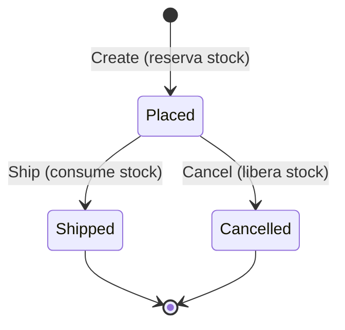
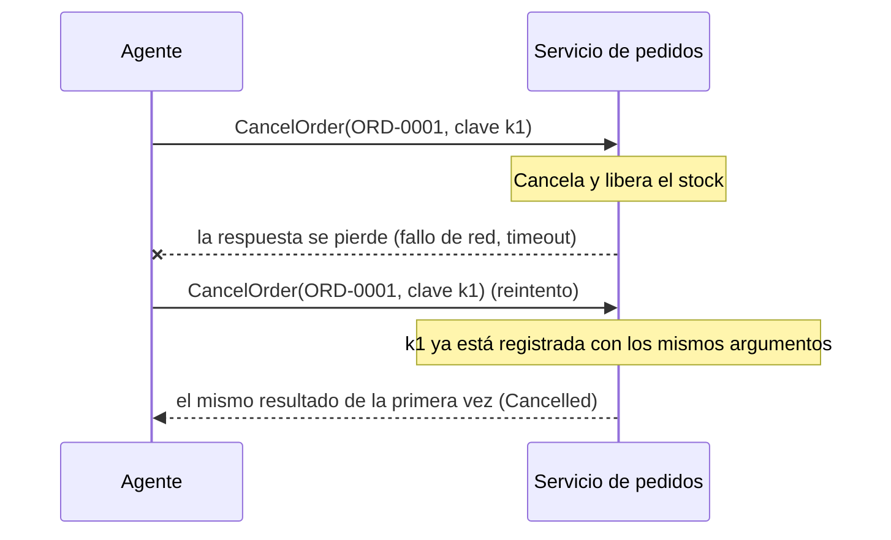

# 11. Diseño de dominios aptos para agentes

> **Estado**: creado con el change `add-order-domain` (fase 3). Explica qué necesita un dominio de negocio para que un agente lo use con seguridad: estados explícitos, errores deterministas, idempotencia y fallos reproducibles. **Verificado**: 2026-11-01 contra Microsoft Learn (*Best practices for exceptions*, *Exceptions and Performance*, *What is TimeProvider?*, *Testing with FakeTimeProvider*, *System.Random class*, `String.GetHashCode`), con los experimentos del explore y con los tests del proyecto. Lo que no se ha podido comprobar se marca **(no verificado)**.

## Qué es y por qué importa aquí

Un agente no es un usuario con una pantalla. Lee los resultados de las tools como texto, decide el siguiente paso con un modelo probabilístico y, cuando algo falla, **reintenta**. Eso cambia lo que se le pide a un dominio:

| Lo que hace el agente | Lo que necesita del dominio | Sección |
|---|---|---|
| Propone acciones que pueden ser imposibles ("cancela el pedido enviado") | Una **máquina de estados explícita** que rechace la transición | [Máquinas de estado](#máquinas-de-estado-explícitas) |
| Interpreta los errores para corregirse | **Códigos estables** con un tipo, y mensajes que digan cómo corregir | [Errores deterministas](#errores-deterministas-con-códigos-estables) |
| No debe ver trazas ni recibir excepciones | Errores como **resultado**, no como excepción | [Patrón *Result*](#el-patrón-result-frente-a-excepciones) |
| Reintenta cuando no recibe respuesta, aunque la acción ya ocurriera | **Idempotencia** en las operaciones que cambian estado | [Idempotencia](#idempotencia-y-la-respuesta-perdida) |
| Necesita leer sin miedo y escribir con cuidado | Lecturas y escrituras **separadas** (CQRS simplificado) | [CQRS](#cqrs-simplificado) |
| Puede pedir dos cosas a la vez | Operaciones **atómicas** sobre el estado | [Atomicidad](#atomicidad-del-estado-in-memory) |
| Se enfrenta a servicios que fallan o tardan | **Fallos inducidos** reproducibles para probar cómo reacciona | [Inyección de fallos](#inyección-de-fallos-reproducible) |

El principio de fondo está en `AGENTS.md`: **el LLM propone, el dominio decide**. El dominio es la última barrera ante una propuesta equivocada, así que no puede depender de que el *prompt* la evite.

## Máquinas de estado explícitas

Un pedido pasa por estados, y no todas las transiciones tienen sentido. Si el código lo expresa con *flags* sueltos (`IsShipped`, `IsCancelled`), las combinaciones absurdas (enviado **y** cancelado) son posibles, y cada operación tiene que acordarse de comprobarlas. Una **máquina de estados explícita** enumera los estados y las transiciones permitidas, y rechaza las demás en un único sitio.

La del pedido en este proyecto:



Cualquier otra transición (cancelar un pedido enviado, enviar uno cancelado, cancelar dos veces) devuelve `INVALID_STATE_TRANSITION` y no toca ni el pedido ni el stock.

Por qué importa con un agente:

- **El modelo no conoce el estado real**: puede haber leído el pedido hace tres turnos. La máquina de estados decide con el estado actual, no con lo que el modelo cree.
- **Cada transición lleva su efecto**: crear reserva stock, cancelar lo libera y enviar lo consume. Al estar en la misma operación que el cambio de estado, no hay forma de cancelar sin liberar.
- **Los estados terminales son explícitos**: `Shipped` y `Cancelled` no tienen salida. Cancelar un pedido ya cancelado **es un error**, no un éxito silencioso (decisión del responsable en el explore). La repetición segura de una misma petición se resuelve con idempotencia, no relajando la máquina de estados.

**Alternativas**: librerías de máquinas de estado (como *Stateless*) dan diagramas, disparadores y guardas configurables **(no verificado en esta sesión)**. Para dos transiciones son excesivas: un `enum` y un método por transición se leen mejor y no añaden dependencias. Si el dominio crece (sagas multipaso, estados intermedios como `Confirmed`), habrá que revisarlo.

## Errores deterministas con códigos estables

Para un agente, un error es una pista para el siguiente paso. Sirve si cumple tres condiciones:

1. **Es estable**: el mismo incumplimiento da siempre el mismo código. Un modelo (y un test, y un guardrail) puede razonar sobre `INSUFFICIENT_STOCK`, pero no sobre un texto que cambia en cada versión.
2. **Tiene un tipo**: no todos los errores piden la misma reacción.
3. **Dice cómo corregir**, sin filtrar detalles internos.

En este proyecto, cada error es un `DomainError(Code, Message, Kind)`:

| Tipo (`ErrorKind`) | Significa | Reacción esperada del agente | Códigos |
|---|---|---|---|
| `Validation` | La petición está mal formada | Corregir los argumentos; repetirla tal cual no sirve | `EMPTY_ORDER`, `INVALID_QUANTITY`, `DUPLICATE_ORDER_LINE`, `INVALID_IDEMPOTENCY_KEY` |
| `NotFound` | El recurso no existe | Comprobar el identificador o preguntar al usuario | `CUSTOMER_NOT_FOUND`, `PRODUCT_NOT_FOUND`, `ORDER_NOT_FOUND` |
| `BusinessRule` | La petición es válida, pero una regla la impide | Explicarlo al usuario o proponer una alternativa | `CUSTOMER_BLOCKED`, `ORDER_LIMIT_EXCEEDED`, `INSUFFICIENT_STOCK` |
| `Conflict` | Choca con el estado actual | Releer el estado antes de decidir | `INVALID_STATE_TRANSITION`, `IDEMPOTENCY_KEY_CONFLICT` |
| `Transient` | Fallo pasajero | Reintentar la misma petición más tarde | `SERVICE_UNAVAILABLE` |

La columna de reacción es criterio de diseño propio, no una norma. La fase 4 derivará de `Kind` el indicador `Retryable` del `ToolError` (solo `Transient`), y la fase 6 comprobará si el agente reacciona así de verdad.

**Mensajes**: van en español, son breves y solo llevan los datos que necesita quien corrige. Por ejemplo, `INSUFFICIENT_STOCK` dice "No hay stock suficiente de SKU-TSHIRT-M: quedan 5 unidades disponibles.", y con eso el agente puede proponer 5 unidades en lugar de 7. Nunca llevan trazas, rutas ni nombres de clases.

**Orden de evaluación**: cuando una petición incumple varias reglas, se devuelve solo la primera, en un orden fijo y especificado: clave, líneas, cliente, cliente bloqueado, productos, importe y stock. Así el resultado es determinista y no depende de detalles de implementación. El orden va de lo más barato y local (el formato) a lo que depende del estado (el stock).

**Formatos fijos**: los números de los mensajes se escriben con la cultura invariante (`1000.00 EUR`), porque la solución entera usa globalización invariante ([ADR 0001](../adr/0001-globalizacion-invariante.md)).

## El patrón *Result* frente a excepciones

Hay dos formas habituales de decir "no se puede":

```csharp
// Con excepción: el error no aparece en la firma
public Order Create(...)            // puede lanzar InsufficientStockException

// Con resultado: el error forma parte del contrato
public Result<Order> Create(...)    // devuelve un Order o un DomainError
```

| | Excepciones | `Result<T>` |
|---|---|---|
| Visible en la firma | No | Sí |
| Obliga a tratar el error | No: si nadie lo captura, sube | Sí: hay que mirar `IsSuccess` para obtener el valor |
| Riesgo con un agente | Un `catch` olvidado deja que la excepción llegue al LLM | El error es un valor y se traduce sin más a `ToolError` |
| Mezcla lo esperado con lo inesperado | Sí, con el mismo mecanismo | No: las excepciones quedan para errores de programación y cancelación |
| Coste de escritura | Bajo en el camino feliz | Algo más verboso |

**Lo que dice la documentación oficial** (Microsoft Learn, consultado el 2026-11-01):

- *Best practices for exceptions* recomienda usar excepciones si el evento "is truly exceptional", y comprobar la condición en el código "if the event happens routinely and could be considered part of normal execution". Un pedido sin stock o un cliente bloqueado son rutinarios.
- Las *Framework Design Guidelines* (extracto en *Exceptions and Performance*) dicen "DO NOT use error codes because of concerns that exceptions might affect performance". Es decir, el rendimiento no es una buena razón para evitar excepciones. Aquí no es la razón: el motivo es que el error forma parte del contrato con el modelo.

La decisión y sus alternativas (excepciones tipadas, librerías como `ErrorOr` o `FluentResults`) están en el [ADR 0003](../adr/0003-errores-de-dominio-como-resultados.md).

**Cómo es aquí**: `Result<T>` es un `record` propio de unas 40 líneas, con `IsSuccess`, `Value` y `Error`. Los atributos `[MemberNotNullWhen]` hacen que el compilador sepa que, si `IsSuccess` es `true`, `Value` no es nulo, y si es `false`, `Error` no lo es. Con `Nullable` activado y los avisos como errores, usar `Value` de un tipo de referencia sin comprobar `IsSuccess` no compila. Con un tipo de valor (`Result<int>`), el compilador no avisa, porque `Value` vale `0`, no `null`.

```csharp
var result = Order.Create(id, customer, lines, stock, now);
if (!result.IsSuccess)
{
    return Result.Failure<OrderView>(result.Error);   // el compilador sabe que Error no es nulo
}

var order = result.Value;                              // y aquí, que Value no lo es
```

**Las excepciones siguen existiendo** para lo que no es una regla incumplida: un argumento nulo (`ArgumentNullException`), un invariante roto por un error de programación (liberar más stock del reservado lanza `InvalidOperationException`) y la cancelación (`OperationCanceledException`), que se propaga siempre.

## Idempotencia y la respuesta perdida

Una operación es **idempotente** si repetirla produce el mismo efecto que hacerla una vez. Leer un pedido lo es por naturaleza; crear un pedido no: cada llamada crea uno nuevo.

Con un agente, la repetición no es un caso raro. El modelo reintenta cuando una tool devuelve un error transitorio, cuando no recibe respuesta o cuando "cree" que no lo ha hecho. El caso más peligroso es la **respuesta perdida**: la operación se ejecutó, pero el resultado no llegó al agente.



Sin clave de idempotencia, el reintento daría `INVALID_STATE_TRANSITION` (el pedido ya está cancelado), y el agente concluiría que algo ha ido mal. Con `PlaceOrder` sería peor: se crearía un pedido duplicado.

**Cómo funciona aquí** (spec `order-operations`):

1. Cada command (`PlaceOrder`, `CancelOrder`, `ShipOrder`) recibe una **clave de idempotencia** obligatoria: de 1 a 64 caracteres, sin caracteres de control y no formada solo por espacios. Si no la cumple, devuelve `INVALID_IDEMPOTENCY_KEY` sin hacer nada.
2. Si la clave ya se usó con **la misma operación y los mismos argumentos**, se devuelve el resultado guardado sin ejecutar nada.
3. Si se usó con otra operación o con otros argumentos, se devuelve `IDEMPOTENCY_KEY_CONFLICT`: es un error de quien llama (ha reutilizado una clave), y esconderlo sería peor.
4. Si es nueva, se ejecuta. **Solo se guardan los éxitos**: si falla por stock insuficiente, la clave queda libre, y el agente puede reintentar con ella cuando haya stock.

Tres decisiones de diseño con sus consecuencias:

- **La huella son los argumentos en el orden recibido**: las mismas líneas en otro orden cuentan como otra petición y dan conflicto. Es lo prudente, porque un reintento real reenvía los mismos argumentos tal cual; normalizar el orden añadiría reglas que especificar y probar. Se comparan los argumentos con comparación ordinal, nunca con `GetHashCode()`, que cambia entre procesos (comprobado en el explore).
- **Se guarda la vista del momento**: si se reintenta un `PlaceOrder` después de cancelar el pedido, devuelve el pedido en `Placed`, como la primera vez. La misma petición recibe la misma respuesta; para conocer el estado actual está `GetOrder`.
- **Las claves no caducan**: el estado vive lo que dura el proceso. Un sistema real necesitaría una caducidad y un almacén persistente.

**Idempotencia frente a relajar la máquina de estados**: se podría haber hecho que cancelar un pedido ya cancelado devolviera éxito. Pero eso ocultaría el caso en que el agente cancela por error un pedido que **otro** ya canceló. Con la clave, el reintento de la misma petición es seguro, y una petición nueva sobre un pedido cancelado sigue siendo un error.

## CQRS simplificado

**CQRS** (*Command Query Responsibility Segregation*) separa las operaciones que **cambian** el estado (*commands*) de las que solo lo **leen** (*queries*). En su forma completa, cada lado puede tener su propio modelo y su propio almacén; aquí se usa la versión mínima: dos interfaces sobre el mismo estado.

| | `ISalesCommands` | `ISalesQueries` |
|---|---|---|
| Operaciones | `PlaceOrder`, `CancelOrder`, `ShipOrder` | `GetOrder`, `GetCustomer`, `GetStock` |
| Cambian el estado | Sí | Nunca (lo comprueba un test, incluido el contador de pedidos) |
| Clave de idempotencia | Obligatoria | No hace falta |
| Riesgo con un agente | Alto: el efecto es real | Bajo: como mucho, gasta *tokens* |

Por qué merece la pena separarlas con un agente:

- **Guardrails distintos** (fase 5): confirmación humana, límites o auditoría solo para los commands.
- **Tools distintas** (fase 4): `AGENTS.md` pide que las tools de lectura y de escritura sean distintas, y esa separación empieza aquí.
- **Inyección de fallos por separado**: el inyector decora cada interfaz por su lado.

Lo que **no** hay: ni bus de mensajes, ni *mediator*, ni eventos de dominio. Las tools recibirán las interfaces por inyección de dependencias. `AGENTS.md` lo pide así: "sin buses ni mediadores salvo necesidad demostrada".

**Vistas compactas**: las operaciones devuelven `record` con solo lo necesario. La vista de stock da el **disponible**, no las existencias ni las reservas: para decidir si se puede pedir, el agente solo necesita ese número, y darle tres le invita a calcular (y a equivocarse).

## Atomicidad del estado in-memory

Un command hace varias cosas que deben ocurrir juntas: comprobar la clave, validar, reservar el stock de todas las líneas, numerar el pedido y guardar el resultado. Si dos llamadas se intercalan, pueden pasar las dos la comprobación de stock y vender más de lo que hay.

**Cómo es aquí**: todo el estado (`SalesState`) está protegido por **un único cerrojo** (`System.Threading.Lock`), y cada command hace todo su trabajo en una sola sección crítica. Dentro no hay nada asíncrono: C# no permite `await` dentro de un `lock`, y la latencia inducida ocurre fuera, en el decorador.

**Lo observado en el apply** (2026-11-01): el test "dos pedidos compiten por el último stock" lanza dos `PlaceOrder` de 5 unidades sobre 5 disponibles, 100 veces. Para comprobar que el test detecta de verdad una carrera, se quitó el `lock` temporalmente:

- en las 3 ejecuciones, el test falló porque **los dos pedidos se crearon**: se vendieron 10 unidades de 5;
- en una de ellas, además, los dos pedidos recibieron el mismo número y el diccionario lanzó `ArgumentException: An item with the same key has already been added. Key: ORD-0001`.

Con el `lock` restaurado, el test pasa siempre. Es decir, la carrera no es teórica: aparece en un portátil con dos hilos y sin esperas artificiales.

**Por qué un solo cerrojo**: con un `ConcurrentDictionary` por entidad, cada acceso sería seguro por separado, pero no el conjunto (comprobar el stock de dos productos y reservar ambos). Un único cerrojo serializa todas las operaciones, lo cual es irrelevante a esta escala. Además, `FunctionInvokingChatClient` invoca las tools en serie por defecto (`AllowConcurrentInvocation = false`, comprobado en el explore), así que la concurrencia no es el caso habitual, pero el estado se protege igualmente.

**Cancelación**: las operaciones comprueban el `CancellationToken` **al entrar**, antes de cualquier efecto. Una vez dentro de la sección crítica, la operación termina: cancelarla a medias dejaría el estado inconsistente.

## Inyección de fallos reproducible

Un servicio real falla: se cae, tarda, pierde respuestas. Para saber cómo reacciona el agente (¿reintenta?, ¿con la misma clave?, ¿se rinde?, ¿informa al usuario?) hay que provocar esos fallos a voluntad. Eso es la **inyección de fallos** (*fault injection*). El requisito de `AGENTS.md` es que sea **reproducible**: "los fallos inducidos se activan por configuración o semilla, nunca al azar sin control".

### Qué puede hacer una regla

El inyector es un **decorador** de `ISalesCommands` y de `ISalesQueries`: envuelve cada operación sin tocar su código. Cada regla se aplica a una operación (o a todas, con `*`) y combina dos cosas:

| Ajuste | Valores | Efecto |
|---|---|---|
| `Trigger` (disparador) | `None`, `Always`, `FirstCalls` (con `Count`), `Probability` (con `Probability`) | Cuándo falla: nunca, siempre, en las N primeras llamadas o con una probabilidad |
| `Timing` (momento) | `Before`, `After` | Si falla antes de ejecutar (nada cambia) o después (los efectos se quedan) |
| `Latency` | De 0 a 30 s | Espera añadida antes de ejecutar, falle o no |

El fallo es siempre `SERVICE_UNAVAILABLE`, de tipo `Transient`: el mensaje invita a reintentar la misma petición.

**`Before` frente a `After`** es la distinción más importante:

- `Before` simula un servicio caído: la petición no llega a ejecutarse, y reintentar es seguro siempre.
- `After` simula una **respuesta perdida**: la operación se ejecuta y conserva sus efectos (incluido el registro de la clave de idempotencia), pero quien llama recibe un error. Es el caso que justifica la idempotencia en los tres commands: el test "respuesta perdida y reintento idempotente" cancela un pedido con un fallo `After` y comprueba que el reintento con la misma clave devuelve el pedido cancelado, sin error.

Ejemplo de configuración (sección `FaultInjection`):

```json
"FaultInjection": {
  "Seed": 42,
  "Rules": [
    { "Operation": "PlaceOrder", "Trigger": "FirstCalls", "Count": 1, "Timing": "After" },
    { "Operation": "GetStock", "Trigger": "Probability", "Probability": 0.3 },
    { "Operation": "*", "Latency": "00:00:00.200" }
  ]
}
```

Si una regla es inválida (operación desconocida, `Count` menor que 1, probabilidad fuera de 0 a 1, latencia fuera de rango o una regla que no hace nada), el Runner no arranca: termina con el código 2 y un mensaje que nombra el ajuste, como `FaultInjection:Rules:1:Probability`.

### Activar el inyector en el Runner

Sin la sección `FaultInjection`, el inyector no hace nada. Para activarlo sin tocar ficheros versionados, se pasan las reglas por línea de comandos o por variables de entorno. Una lista se configura por índices (`Rules:0`, `Rules:1`...), y en las variables de entorno el separador `:` se escribe `__`:

```bash
# Línea de comandos: la primera llamada a PlaceOrder pierde su respuesta; GetStock tarda 200 ms
dotnet run --project src/Sandbox.Runner -- \
  --FaultInjection:Rules:0:Operation=PlaceOrder \
  --FaultInjection:Rules:0:Trigger=FirstCalls \
  --FaultInjection:Rules:0:Count=1 \
  --FaultInjection:Rules:0:Timing=After \
  --FaultInjection:Rules:1:Operation=GetStock \
  --FaultInjection:Rules:1:Latency=00:00:00.200

# Variables de entorno: lo mismo para la primera regla
export FaultInjection__Rules__0__Operation=PlaceOrder
export FaultInjection__Rules__0__Trigger=FirstCalls
export FaultInjection__Rules__0__Count=1
export FaultInjection__Rules__0__Timing=After
```

Lo observado al ejecutar el Runner el 2026-11-01 con una probabilidad de 1,5: termina con el código 2 sin llamar al modelo, y escribe en la salida de errores "Configuración inválida: FaultInjection:Rules:0:Probability es obligatoria con Probability y debe estar entre 0 y 1.". En la fase 3 el saludo todavía no usa las operaciones, así que una configuración válida no cambia nada visible: los fallos inducidos se notarán cuando las tools de la fase 4 llamen a los servicios. Cómo se valida la sección al arrancar, y qué pasa si además falta la clave, está en el [documento 10](10-configuracion-y-secretos-en-net.md#varias-secciones-validadas-al-arrancar).

### Por qué se decide el plan antes de ejecutar

En cada llamada, el inyector calcula primero un **plan** (latencia total, si falla, qué regla lo decide y en qué momento) y después lo aplica. Todas las reglas que cubren la operación avanzan su recuento y su secuencia aleatoria **en cada llamada**, falle o no otra regla. Un test lo fija con dos reglas `FirstCalls` sobre la misma operación (N = 1 y N = 2): fallan la primera y la segunda llamada, y no la tercera. Para comprobar que el test detecta el error, se hizo temporalmente que el inyector dejara de evaluar las reglas posteriores a la que falla, y entonces falló también la tercera.

Así, el patrón de fallos depende solo de la configuración, la semilla y la secuencia de llamadas, nunca de cuánto tarde la operación ni de lo que devuelva. Si el fallo se decidiera después de ejecutar, en función del resultado, dos ejecuciones con datos distintos darían patrones distintos. Es criterio de diseño propio.

### `TimeProvider` y relojes falsos

La latencia es tiempo, y los tests no deben esperar de verdad. Desde .NET 8, `TimeProvider` es la abstracción del reloj: `GetUtcNow()`, temporizadores y, con `Task.Delay(TimeSpan, TimeProvider, CancellationToken)`, esperas. En producción se usa `TimeProvider.System`. En los tests, `FakeTimeProvider` (paquete `Microsoft.Extensions.TimeProvider.Testing`) es un reloj que **solo avanza cuando el test llama a `Advance`**.

Lo que dice Microsoft Learn (consultado el 2026-11-01):

- *Testing with FakeTimeProvider* recomienda inyectar siempre `TimeProvider` en lugar de usar `DateTime` directamente, avanzar el tiempo "deliberately" y no mezclar el reloj real y el falso en el mismo test;
- en la referencia de `FakeTimeProvider.Advance`: "for the fake time provider the application is responsible for doing this explicitly by calling this method".

Lo que observamos en el explore (scratchpad, SDK 10.0.403, paquete 10.11.0):

- `Task.Delay(200 ms, fake)` no completa tras `Advance(199 ms)` y sí tras 1 ms más, en unos 13 ms reales;
- **la trampa**: si el test hace `await` de esa espera antes de llamar a `Advance`, **se queda colgado**, porque nadie mueve el reloj (tras 500 ms reales seguía sin completar);
- `Task.Delay(TimeSpan.Zero, fake)` completa al instante, y cancelar durante la espera lanza `TaskCanceledException`, que deriva de `OperationCanceledException`.

De ahí el patrón que siguen los tests de latencia de este proyecto:

```csharp
var getting = harness.GetOrderAsync("ORD-9999");     // 1. lanzar sin await
Assert.False(getting.IsCompleted);                   // 2. comprobar que espera
harness.Sales.Clock.Advance(TimeSpan.FromMilliseconds(200));  // 3. mover el reloj
var result = await getting.WaitAsync(TestContext.Current.CancellationToken);  // 4. ahora sí
```

Y esos tests llevan `[Fact(Timeout = ...)]`, para que un cuelgue sea un fallo y no un test que nunca termina. xUnit v3 exige además que un test con `Timeout` use `TestContext.Current.CancellationToken` (regla xUnit1069, observada al compilar).

El mismo reloj fija la fecha de creación de los pedidos, así que un test puede comprobar la fecha exacta (`2026-11-01T10:00:00Z`).

### `Random` con semilla: lo que garantiza y lo que no

El disparador `Probability` usa `System.Random` con semilla: la regla de índice `i` usa `Seed + i`, y cada regla tiene su propio generador. Lo que dice Microsoft Learn (*System.Random class*, notas complementarias, consultado el 2026-11-01):

- "The implementation of the random number generator in the Random class isn't guaranteed to remain the same across major versions of .NET. As a result, you shouldn't assume that the same seed will result in the same pseudo-random sequence in different versions of .NET."
- "Random objects are not thread safe. [...] calls to methods that return random numbers return 0." Con `p > 0`, devolver 0 significa **fallar siempre**.

Consecuencias en el diseño:

- **Reproducible en el mismo runtime, no entre versiones**: con la semilla 42, la secuencia fue la misma en dos ejecuciones del explore (`0.668, 0.141, 0.126...`), pero los tests **no fijan** qué llamada concreta falla. Comparan dos inyectores con la misma semilla, comprueban que las llamadas a otras operaciones no alteran el patrón y prueban los extremos (`p = 0` nunca falla; `p = 1` falla siempre, porque `NextDouble()` devuelve valores en `[0, 1)`).
- **Un generador por regla**, para que las llamadas a otra operación no consuman números de la secuencia de esta regla.
- **El generador se usa con el cerrojo del inyector tomado**, porque no es seguro entre hilos.
- **Nunca se deriva una semilla de `GetHashCode()`** de una cadena: en el explore, `"PlaceOrder".GetHashCode()` dio `2062505648` en una ejecución y `667311391` en otra. La referencia de `String.GetHashCode` lo advierte: "two subsequent runs of the same program may return different hash codes" (Microsoft Learn, consultado el 2026-11-01).
- Si un escenario necesita un fallo en una llamada exacta, se usa `FirstCalls`, no `Probability`.

### Registro

Cada fallo inducido se registra como `Warning`, con la operación, la regla que lo decide, el momento y la latencia total aplicada ("Fallo inducido en PlaceOrder: regla 0, momento After, latencia 0 ms"). Cada latencia se registra como `Information`, con la operación, las reglas que la aportan y los milisegundos. **Nunca se registran los argumentos** (cliente, líneas o clave), y lo comprueba un test. Con `LoggerMessage`, una lista de reglas se escribe como `[0, 1]` (observado en el apply).

**Alternativas**: Polly y `Microsoft.Extensions.Resilience` incluyen estrategias de *chaos engineering* que inyectan fallos y latencia **(no verificado en esta sesión)**. Son la opción natural en un sistema real, pero para un laboratorio añaden una dependencia grande y ocultan justo lo que se quiere aprender. Inyectar los fallos dentro de los servicios mezclaría el fallo simulado con la lógica de negocio.

## Cómo se aplica en este proyecto

| Pieza | Dónde |
|---|---|
| `Result<T>`, `DomainError`, `ErrorKind` y `ErrorCodes` | [`src/Sandbox.Domain/Results/`](../../src/Sandbox.Domain/Results/) |
| Pedido, cliente, stock, límites y mensajes de error | [`src/Sandbox.Domain/Sales/`](../../src/Sandbox.Domain/Sales/) |
| Commands, queries, vistas, estado, idempotencia y catálogo semilla | [`src/Sandbox.Application/Sales/`](../../src/Sandbox.Application/Sales/) |
| Tests del dominio (uno por escenario de la spec) | [`tests/Sandbox.Domain.Tests/`](../../tests/Sandbox.Domain.Tests/) |
| Tests de las operaciones, la idempotencia y la concurrencia | [`tests/Sandbox.Application.Tests/Sales/`](../../tests/Sandbox.Application.Tests/Sales/) |
| Inyector de fallos: opciones, validador, inyector y decoradores | [`src/Sandbox.Application/FaultInjection/`](../../src/Sandbox.Application/FaultInjection/) |
| Tests del inyector (incluidos los de latencia con reloj falso) | [`tests/Sandbox.Application.Tests/FaultInjection/`](../../tests/Sandbox.Application.Tests/FaultInjection/) |
| Requisitos | Specs `order-domain`, `order-operations` y `fault-injection` (`openspec/specs/`) |
| Decisión sobre los errores | [ADR 0003](../adr/0003-errores-de-dominio-como-resultados.md) |
| Decisiones y experimentos | `design.md` del change `add-order-domain` |

## Errores típicos

- **Relajar la máquina de estados para "ayudar" al agente**, por ejemplo devolviendo éxito al cancelar algo ya cancelado. Oculta errores reales del modelo; la repetición segura se resuelve con idempotencia.
- **Mensajes de error con trazas o nombres internos**: no ayudan al modelo, gastan *tokens* y pueden filtrar información.
- **Mensajes sin el dato que permite corregir**: "stock insuficiente" a secas obliga al agente a hacer otra consulta.
- **Códigos que cambian entre versiones**, o textos libres en lugar de códigos: rompen los *prompts*, los guardrails y los tests que dependen de ellos.
- **Validar en un orden no especificado**: el mismo error de entrada puede dar códigos distintos según cambie la implementación.
- **Usar excepciones para reglas de negocio** y confiar en capturarlas todas en el borde de la tool.
- **Idempotencia solo en la creación**: la respuesta perdida también afecta a cancelar o enviar.
- **Guardar también los errores en el almacén de idempotencia**: el agente no podría reintentar con la misma clave cuando cambie la situación.
- **Comprobar la clave fuera de la sección crítica** (por ejemplo, en un decorador aparte): dos llamadas con la misma clave pueden pasar la comprobación a la vez y ejecutarse dos veces.
- **Derivar una huella o una semilla de `GetHashCode()`** de una cadena: cambia entre procesos.
- **Hacer algo asíncrono, o esperar, dentro del cerrojo.**
- **Hacer `await` de una espera con reloj falso antes de llamar a `Advance`**: el test se queda colgado.
- **Fijar en un test qué llamada falla con una semilla concreta**: puede cambiar al subir de versión mayor de .NET.
- **Compartir un `Random` entre hilos sin protegerlo**: puede devolver 0 siempre.
- **Inducir fallos al azar sin semilla** o dentro de la lógica de negocio.

## Referencias

- `AGENTS.md`, secciones 2 (principios) y 4 (reglas de tools).
- Microsoft Learn, *Best practices for exceptions*: https://learn.microsoft.com/dotnet/standard/exceptions/best-practices-for-exceptions
- Microsoft Learn, *Exceptions and Performance* (*Framework Design Guidelines*): https://learn.microsoft.com/dotnet/standard/design-guidelines/exceptions-and-performance
- Microsoft Learn, atributos de análisis de nulos (`MemberNotNullWhen`): https://learn.microsoft.com/dotnet/csharp/language-reference/attributes/nullable-analysis
- Microsoft Learn, *What is TimeProvider?*: https://learn.microsoft.com/dotnet/standard/datetime/timeprovider-overview
- Microsoft Learn, *Testing with FakeTimeProvider*: https://learn.microsoft.com/dotnet/core/extensions/timeprovider-testing
- Microsoft Learn, `FakeTimeProvider.Advance`: https://learn.microsoft.com/dotnet/api/microsoft.extensions.time.testing.faketimeprovider.advance
- Microsoft Learn, `Task.Delay(TimeSpan, TimeProvider, CancellationToken)`: https://learn.microsoft.com/dotnet/api/system.threading.tasks.task.delay
- Microsoft Learn, *System.Random class* (notas complementarias: reproducibilidad y seguridad entre hilos): https://learn.microsoft.com/dotnet/fundamentals/runtime-libraries/system-random
- Microsoft Learn, `String.GetHashCode` (el *hash* no es estable entre ejecuciones): https://learn.microsoft.com/dotnet/api/system.string.gethashcode
- [Documento 01](01-ia-agentica-en-sistemas-transaccionales.md): por qué un dominio transaccional necesita idempotencia y límites de negocio cuando lo usa un agente.
