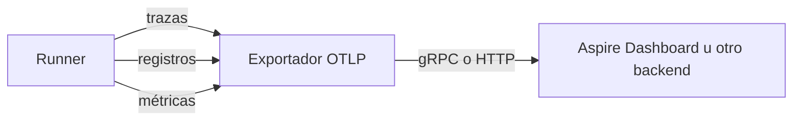
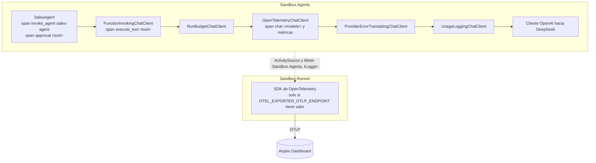

# 13. Observabilidad de agentes

> **Estado**: creado con el change `add-agent-observability` (fase 5). Explica cómo se observa un agente por dentro con OpenTelemetry: trazas, registros y métricas, qué emite `Microsoft.Extensions.AI`, qué añade el proyecto, qué no debe salir nunca en la telemetría y cómo se ve todo en el Aspire Dashboard. **Verificado**: 2026-11-06 y 2026-11-07 contra Microsoft Learn (referencia de `OpenTelemetryChatClient`, *Use OpenTelemetry with OTLP and the Aspire Dashboard*, *Use the IChatClient interface*), GitHub Docs (ecosistemas de Dependabot), la API de NuGet y el registro de MCR; con dos spikes (sin Docker y con Docker), tests de aprendizaje y ejecuciones reales del Runner. Lo que no se ha podido comprobar se marca **(no verificado)**. Lo observado no es lo mismo que lo documentado: cuando algo solo se ha visto en una prueba, se dice.

## Qué es y por qué importa

Observar un sistema es poder responder a preguntas sobre lo que hizo **sin añadir código nuevo para cada pregunta**. En un agente las preguntas típicas son:

- ¿Qué llamada al modelo pidió esta tool? ¿Con qué resultado volvió?
- ¿Cuánto tardó cada paso? ¿Cuánto de ese tiempo fue el modelo, cuánto las tools y cuánto una persona aprobando?
- ¿Qué vuelta del bucle se comió los tokens?
- ¿Por qué paró: terminó, o lo paró un guardrail?

Hasta la fase 5, el Runner respondía con **registros planos**: una línea por llamada al modelo (modelo, duración, tokens) y los eventos de auditoría de `Sandbox.Audit`, todos con el identificador de la ejecución. Eso dice *qué* pasó, pero no *dentro de qué* ni *en qué orden relativo*: para reconstruir una ejecución hay que leer las líneas y ordenarlas mentalmente. Una **traza** da esa estructura hecha.

Un agente es más difícil de observar que un servicio web normal. El camino lo decide el modelo en cada ejecución, cambia de una vez a otra con la misma petición, y puede incluir pausas largas (una persona que aprueba). Sin trazas, depurar "por qué esta vez canceló el pedido equivocado" es arqueología.

## Las tres señales



| Señal | Qué es | Pregunta que responde | En este proyecto |
|---|---|---|---|
| **Traza** | Árbol de **spans**: unidades de trabajo con nombre, inicio, duración, atributos, estado y un padre | ¿Qué pasó, en qué orden y dentro de qué? | Una por ejecución del agente |
| **Registro** (*log*) | Evento puntual con mensaje y propiedades | ¿Qué ocurrió exactamente en este instante? | Los de siempre, incluida la auditoría, ahora enlazados con su span |
| **Métrica** | Valor agregado en el tiempo (contador, histograma) | ¿Cuánto, cuántas veces, con qué distribución? | Solo las de `Microsoft.Extensions.AI`: duración de las llamadas y tokens |

Lo que une las tres es el **contexto de traza**: el identificador de la traza y del span en curso. En .NET, el span es una `Activity` y el contexto viaja con ella por el flujo asíncrono. Un registro emitido mientras hay un span activo lleva su `TraceId` y su `SpanId`, y por eso el panel puede ir del registro al span y al revés.

## OpenTelemetry y OTLP

**OpenTelemetry** es un estándar abierto (de la CNCF) para generar y transportar telemetría, con un SDK por lenguaje. En .NET, la generación ya está en la plataforma: `ActivitySource` crea spans, `Meter` crea métricas e `ILogger` emite registros. El SDK de OpenTelemetry se limita a **recoger** lo que emiten esas APIs y **exportarlo**.

- **`ActivitySource` sin oyentes no crea nada**: `StartActivity` devuelve `null` y no cuesta. Por eso el código del agente puede emitir spans siempre; solo existen si alguien escucha (el SDK, o un test).
- **OTLP** (*OpenTelemetry Protocol*) es el formato estándar de transporte, sobre gRPC (puerto 4317 por convención) o HTTP con Protobuf (4318, rutas `/v1/traces`, `/v1/logs` y `/v1/metrics`).
- **Exportador**: el componente que envía. Aquí, el OTLP. Para pruebas se puede usar uno en memoria o de consola.
- **Recurso**: quién emite. Lleva el nombre del servicio y, por defecto, un identificador de instancia aleatorio por proceso.
- **Opciones estándar**: el exportador lee variables con nombre fijo, como `OTEL_EXPORTER_OTLP_ENDPOINT`, `OTEL_EXPORTER_OTLP_PROTOCOL` o `OTEL_EXPORTER_OTLP_TIMEOUT`. Comprobado en el apply: en un host genérico de .NET las toma de la **configuración** del host, no solo del entorno, así que llegan también por línea de comandos.

## Convenciones semánticas GenAI

Para que cualquier backend entienda la telemetría de un LLM, OpenTelemetry define **convenciones semánticas para IA generativa**: nombres de spans (`chat <modelo>`, `execute_tool <tool>`, `invoke_agent <agente>`) y atributos con prefijo `gen_ai.` (`gen_ai.request.model`, `gen_ai.usage.input_tokens`, `gen_ai.tool.name`…).

La referencia de `OpenTelemetryChatClient` dice que implementa la versión **v1.41** de esas convenciones y que la especificación **aún es experimental**: los nombres pueden cambiar entre versiones. Consecuencias aquí:

- Los atributos que el proyecto añade y que no tienen equivalente estándar usan un prefijo propio, `sandbox.`, para no inventar nombres dentro de un espacio ajeno.
- Los tests solo fijan los atributos imprescindibles (`gen_ai.operation.name`, tokens). Lo demás lo cubren los tests de aprendizaje, que avisan si la librería cambia.

## Cómo está implementado en este proyecto



- **Una sola fuente**, `Sandbox.Agents`, para los spans propios y como `sourceName` del cliente de telemetría del modelo. El Runner la registra en trazas (`AddSource`) y métricas (`AddMeter`).
- **Los paquetes de OpenTelemetry solo están en el Runner**, la raíz de composición. El agente solo usa `System.Diagnostics` y `UseOpenTelemetry` de `Microsoft.Extensions.AI`. Dominio y aplicación no saben nada: la auditoría les da voz por `ILogger`, que el SDK exporta.
- **Sin endpoint, no se registra nada**: ni proveedores ni exportador. Un endpoint inválido termina con el código 2, como cualquier opción inválida.

### La traza de una ejecución

```text
invoke_agent sales-agent        sandbox.run.id, sandbox.stop_reason, sandbox.model_calls, tokens
├─ chat deepseek-flash          gen_ai.request.model, gen_ai.response.model, gen_ai.usage.*
├─ execute_tool get_order       gen_ai.tool.name, gen_ai.tool.call.id, sandbox.tool.outcome
├─ chat deepseek-flash
├─ approval cancel_order        gen_ai.tool.name, sandbox.approval.decision (dura lo que tarda la persona)
├─ execute_tool cancel_order
└─ chat deepseek-flash
```

| Span | Lo abre | Atributos principales |
|---|---|---|
| `invoke_agent sales-agent` | `SalesAgent` | `gen_ai.operation.name`, `gen_ai.agent.name`, `sandbox.run.id` (el mismo `RunId` de la auditoría), y al cerrar `sandbox.stop_reason`, `sandbox.model_calls` y los tokens. En error si para un guardrail (descripción: el motivo) o sale una excepción (descripción: **solo el tipo**) |
| `chat <modelo>` | `OpenTelemetryChatClient` | Modelo pedido y modelo que respondió, servidor, tokens, nombres de las tools ofrecidas. Con captura de contenido, también los mensajes |
| `execute_tool <tool>` | `FunctionInvokingChatClient` | Nombre, identificador de la petición y descripción de la tool; el proyecto añade `sandbox.tool.outcome` (`OK` o el código de error, también `BLOCKED_BY_POLICY`) |
| `approval <tool>` | `SalesAgent` | Tool y decisión (`Approved` o `Denied`). **Nunca** los argumentos |

### El nombre del span raíz importa (hallazgo)

En el explore se vio que, **sin** span raíz propio, `FunctionInvokingChatClient` abre un span `orchestrate_tools` como raíz en cada llamada. Con la pausa de aprobación, el agente lo llama dos veces, así que una ejecución con confirmación salía **partida en dos trazas**, con el span de aprobación suelto.

Con un span raíz llamado `invoke_agent sales-agent` se obtiene una sola traza, y además la librería deja de abrir `orchestrate_tools`. Los tests de aprendizaje del apply afinaron la causa **observada**: lo que cuenta es el **nombre** del span ambiente, no su atributo `gen_ai.operation.name`.

| Span ambiente | `orchestrate_tools` | Trazas con una pausa | Fuente de `execute_tool` | Argumentos en `execute_tool` (con captura) |
|---|---|---|---|---|
| Ninguno | Uno por llamada, como raíz | **Dos** | La del cliente de chat | Sí |
| `root` (aunque lleve `gen_ai.operation.name = invoke_agent`) | Uno por llamada, hijo del ambiente | Una | La del cliente de chat | Sí |
| `invoke_agent sales-agent` | **Ninguno** | Una | **La del span ambiente** | **No** |

No se ha mirado el código de la librería; es comportamiento observado en la 10.11.0 y no documentado. Lo fijan `TelemetryLearningTests`. El nombre del span raíz es, por tanto, parte del funcionamiento y no solo una convención: está en una constante (`AgentTelemetry.InvokeAgentSpanName`) con un comentario que lo explica.

La última columna es una rareza que se aceptó: con la captura activada, los argumentos y resultados siguen viéndose dentro de los mensajes de los spans `chat`.

### Registros correlacionados

Con la exportación activa, el proveedor de registros de OpenTelemetry se suma a la consola, con dos opciones:

- `IncludeScopes = true`: las propiedades del *scope* de ejecución (`RunId`, `CustomerId`) viajan como atributos de cada registro.
- `IncludeFormattedMessage = true`: **sin ella, el cuerpo del registro exportado es la plantilla** (`Tool {Tool}: resultado {Outcome}`) y el panel muestra eso en la columna del mensaje. Se vio en la UI durante el explore y se confirmó capturando el cuerpo OTLP: con la opción, el cuerpo es `Tool get_order: resultado ok`, y la plantilla queda como atributo.

Como `ToolInvoked` se emite dentro del `FunctionInvoker`, que corre dentro del span `execute_tool`, el evento queda enlazado con ese span. Lo mismo pasa con `ApprovalDecided` y el span `approval`.

### Recurso: un servicio, no un proceso por ejecución

En el explore, cada ejecución aparecía en el panel como un recurso distinto (`spike-runner-fbc9e104`, `spike-runner-4cd995a6`…). Es el identificador de instancia que el SDK genera por proceso, y el Runner es un proceso por ejecución. El proyecto registra el servicio `sandbox-runner` sin identificador de instancia, y el panel agrupa entonces todas las ejecuciones en un solo recurso: comprobado con dos ejecuciones en compose y una con `dotnet run`.

## Lo que nunca debe salir en la telemetría

La telemetría es una **vía de salida de datos** nueva, paralela a la consola. Las reglas están en el [ADR 0006](../adr/0006-telemetria-opcional-y-sin-contenido.md):

1. **Desactivada por defecto.** Solo se exporta con `OTEL_EXPORTER_OTLP_ENDPOINT`.
2. **Sin contenido por defecto.** Con `Telemetry:CaptureContent=true`, los spans `chat` llevan los mensajes (instrucciones del sistema, petición, argumentos y resultados de las tools) y las definiciones completas de las tools. El Runner avisa al arrancar. El contenido **nunca** llega a la consola: el cliente de telemetría se crea sin `ILoggerFactory`.
3. **Nunca el texto de error del proveedor.** Este es el hallazgo más serio del change. `OpenTelemetryChatClient` copia **el mensaje de la excepción** en el estado del span (`StatusDescription`), y DeepSeek devuelve en el 401 los cuatro últimos caracteres de la clave. Si el cliente de telemetría quedara **por dentro** del traductor de errores, el panel mostraría `...api key: ****abcd...`. Va **por fuera**, así que solo ve `ChatProviderException`, cuyo mensaje no lleva el texto del proveedor.

El punto 3 se comprobó de tres formas:

- con un test de aprendizaje, que fija que la librería copia el mensaje;
- con un test del pipeline que falla si se invierte el orden (se invirtió a propósito en el apply y falló);
- de extremo a extremo con DeepSeek: una clave falsa, un receptor OTLP de prueba y 2.164 bytes exportados sin el fragmento de la clave ni el texto del proveedor.

En `ChatClientBuilder`, el primer `Use` queda **por fuera**: por eso `UseOpenTelemetry` se añade antes que el traductor.

La variable estándar de las convenciones GenAI para capturar contenido (`OTEL_INSTRUMENTATION_GENAI_CAPTURE_MESSAGE_CONTENT`) **no tiene efecto** en `Microsoft.Extensions.AI` 10.11.0: se probó y la cadena no está en el ensamblado. De ahí la opción propia.

## Procesos one-shot: vaciado y el coste de un endpoint sin receptor

El exportador envía por lotes en segundo plano. En un servicio que corre días eso no importa; en el Runner, que termina en segundos, lo pendiente se perdería si nadie lo envía al salir. No hace falta código: los proveedores de OpenTelemetry se liberan con el host, y al liberarse vacían lo pendiente. En el explore, el cierre tardó entre 230 y 530 ms con el panel escuchando. En el apply, una ejecución que terminó con el código 3 (clave rechazada) también envió sus trazas, métricas y registros.

La otra cara: **con el endpoint puesto y nadie escuchando, el Runner tarda unos 8,7 s más en salir en local, y unos 11,9 s en compose** (el nombre `dashboard` no resuelve), sin ningún mensaje. Por eso el endpoint está vacío por defecto y, cuando hay uno, el Runner dice al arrancar hacia dónde envía (solo esquema, host y puerto: una URL con credenciales embebidas no las deja en el registro).

## El panel: Aspire Dashboard

El **Aspire Dashboard** es la parte de .NET Aspire que muestra trazas, registros y métricas. Existe como **contenedor autónomo**: recibe OTLP de cualquier aplicación, esté hecha o no con Aspire. Microsoft lo presenta como herramienta de **desarrollo**, no de monitorización en producción. Uso, endurecimiento y lo que hizo falta para que arrancara con el sistema de ficheros de solo lectura están en el [documento 07](07-contenedores-en-sistemas-agenticos.md).

```bash
docker compose --profile dashboard up -d dashboard
docker compose logs dashboard        # URL con el token de acceso
OTEL_EXPORTER_OTLP_ENDPOINT=http://dashboard:18889 docker compose run --build --rm runner --scenario happy-order
OTEL_EXPORTER_OTLP_ENDPOINT=http://localhost:4317 dotnet run --project src/Sandbox.Runner -- --scenario cancel-order
```

## Lo observado con DeepSeek

Tres ejecuciones reales el 2026-11-07, con el panel 13.6.4 en compose:

| Ejecución | Cómo | Llamadas | Tokens (entrada / salida) | Duración | Resultado |
|---|---|---|---|---|---|
| `happy-order`, sin contenido | `docker compose run` hacia `http://dashboard:18889` | 3 | 4.562 / 170 | 7 s en total | Código 0 |
| `happy-order`, con `Telemetry__CaptureContent=true` | Igual, con `-e` | 3 | 4.564 / 178 | 8 s | Código 0; el aviso de contenido al arrancar |
| `cancel-order`, con aprobación real | `dotnet run` hacia `http://localhost:4317` | 2 | 2.829 / 120 | La aprobación tardó unos **69 s** | Código 0 |

- **Una sola traza por ejecución**, también con la pausa de aprobación. Los registros de la consola lo muestran: en `cancel-order`, el evento `ApprovalDecided`, el `ToolInvoked` de `cancel_order` y las dos llamadas al modelo llevan el mismo `TraceId` y el mismo padre, el span raíz. La espera humana de 69 s queda dentro de esa traza, como duración del span `approval cancel_order`.
- **Cada registro, dentro de su span**: el de uso del modelo (`UsageLoggingChatClient`) cae en el span `chat` de su llamada, porque está por dentro del cliente de telemetría; `ToolInvoked` cae en su `execute_tool`; `ApprovalDecided`, en `approval`; y el texto intermedio, en el raíz.
- **Un solo recurso**: el panel mostró las tres ejecuciones (dos con compose y una con `dotnet run`) como un único `sandbox-runner`.
- **La traza en el panel** (`happy-order` sin contenido): raíz `invoke_agent sales-agent` de 3,8 s, con profundidad 2. Debajo, tres `chat deepseek-flash` (1,3 s, 1,29 s y 0,94 s, cada uno con el servidor `api.deepseek.com` como destino) y dos `execute_tool` (33 ms y 38 ms), sin ningún `orchestrate_tools`. El raíz lleva `sandbox.stop_reason` = `Completed`, `sandbox.model_calls` = 3, 4.562 y 170 tokens, el `sandbox.run.id`, la fuente `Sandbox.Agents` y el recurso `sandbox-runner` con el SDK 1.20.1. Casi todo el tiempo es del modelo: las tools suman unos 70 ms de 3,8 s.
- **Visor de LLM del panel**: en los spans `chat` (y en los registros emitidos dentro de ellos) el panel muestra un icono ✧ que abre una vista de la conversación construida a partir de los atributos `gen_ai.*`. Con la captura de contenido activada se ven el mensaje de sistema completo, el del usuario ("Hola, quiero pedir dos tazas rojas, por favor."), la salida del asistente con el texto intermedio y la llamada a `list_products()`, la pestaña de las 6 tools ofrecidas, la duración y los tokens de esa llamada. Es la forma más directa de ver qué recibe el modelo en cada vuelta: justo lo que, en un sistema con datos reales, no debe guardarse sin una decisión expresa.
- **Métricas**: con una llamada de saludo real contra un receptor OTLP de prueba, se exportaron `gen_ai.client.token.usage` (con `gen_ai.token.type` de entrada y de salida) y `gen_ai.client.operation.duration`, bajo el servicio `sandbox-runner`. Se comprobó en lo que llega por OTLP, no en la vista de métricas del panel.
- **Mensajes formateados** en la vista de registros (`Tool list_products: decisión Allowed, resultado OK en 22 ms`), cada uno con el enlace a su traza. La línea "Telemetría OTLP activa hacia …" sale sin traza: se emite antes de la ejecución.
- **Efecto inesperado en la consola**: con la telemetría activa, cada línea registrada lleva delante `SpanId:…, TraceId:…, ParentId:…`, además del *scope* de ejecución. Los añade el host genérico de .NET cuando hay un span en curso. Sin telemetría no hay oyentes, `StartActivity` no crea spans, y esas líneas no aparecen. Solo cambian los registros (salida de errores), no la salida estándar.
- **El modelo no siempre sigue el mismo camino**: en `cancel-order` fue directo a `cancel_order`, sin consultar antes el pedido con `get_order`. La traza lo hace evidente de un vistazo.
- **Coste de la telemetría**: no se ha medido de forma comparativa **(no verificado)**. Lo único medido es el vaciado al terminar, de 230 a 530 ms en el explore. Las llamadas al modelo (de 0,8 a 1,7 s cada una) dominan con mucho la duración.

## Cómo se prueba sin red

- **Oyente de spans en memoria** (`SpanRecorder`): un `ActivityListener` que muestrea todo lo de las fuentes indicadas y guarda los spans terminados. Es global al proceso, así que los tests que lo usan van en una colección sin paralelismo.
- **No se filtra por un span padre del test**, como se pensó al principio: ese padre cambiaba lo que se observaba (ver "El nombre del span raíz importa").
- **Runner**: se comprueba que sin endpoint no hay `TracerProvider` en el contenedor de servicios, que con uno inválido el código es 2, y que la salida es la misma con exportación y sin ella. Para que el vaciado contra un puerto sin receptor no alargue el test, se baja el tiempo de espera con `--OTEL_EXPORTER_OTLP_TIMEOUT=500`.
- **Lo que necesita un receptor real** (el vaciado y la vista en el panel) se comprueba a mano, con el panel en compose.

## Alternativas

| Opción | Ventaja | Inconveniente | Aquí |
|---|---|---|---|
| Solo registros estructurados | Nada nuevo que operar | Sin estructura temporal ni enlace entre pasos | Era lo que había; se mantiene en la consola |
| `LoggingChatClient` (`UseLogging`) de M.E.AI | Una línea por petición y respuesta, sin SDK | Más registros planos, y con contenido por defecto a nivel de depuración **(no verificado)** | No |
| OpenTelemetry + Aspire Dashboard | Un contenedor, trazas, registros y métricas en la misma UI | Herramienta de desarrollo, guarda en memoria | **Sí** |
| OpenTelemetry + Prometheus, Grafana y Jaeger | Herramientas de producción | Más piezas y configuración (lo dice la propia guía de Microsoft) | No |
| OpenTelemetry + `grafana/otel-lgtm` | Todo en un contenedor (Tempo, Loki, Mimir y Grafana) | Más pesado; citado en la documentación de Microsoft, no probado aquí **(no verificado)** | No |

## Errores típicos

- Poner el cliente de telemetría por dentro del traductor de errores: el panel muestra el texto del proveedor (y aquí, un trozo de la clave).
- Registrar la excepción completa en un span (`AddException`): copia mensaje y traza.
- Activar la captura de contenido "solo para probar" y olvidarla; o creer que la variable estándar la activa (en la 10.11.0, no).
- Dejar un endpoint configurado sin receptor: cada ejecución tarda segundos de más y no avisa.
- Exportar registros sin `IncludeFormattedMessage`: el panel muestra plantillas en lugar de mensajes.
- Llamar al bucle de tools varias veces (pausas de aprobación) sin un span raíz: la ejecución se parte en varias trazas.
- Filtrar los spans de un test con un span padre propio: el padre cambia el comportamiento de la librería.
- Fijar en los tests todos los atributos `gen_ai.*`: las convenciones son experimentales.
- Publicar el OTLP del panel en todas las interfaces: no tiene autenticación.

## Referencias

- Microsoft Learn, [`OpenTelemetryChatClient`](https://learn.microsoft.com/dotnet/api/microsoft.extensions.ai.opentelemetrychatclient) (convenciones GenAI v1.41, experimentales; consultado el 2026-11-06).
- Microsoft Learn, [Use the IChatClient interface: telemetría](https://learn.microsoft.com/dotnet/ai/ichatclient#use-telemetry).
- Microsoft Learn, [Use OpenTelemetry with OTLP and the Aspire Dashboard](https://learn.microsoft.com/dotnet/core/diagnostics/observability-otlp-example) (contenedor autónomo, token de acceso, herramienta de desarrollo; consultado el 2026-11-06).
- OpenTelemetry, [convenciones semánticas para IA generativa](https://opentelemetry.io/docs/specs/semconv/gen-ai/) y [variables de entorno del SDK](https://opentelemetry.io/docs/specs/otel/configuration/sdk-environment-variables/).
- [ADR 0006](../adr/0006-telemetria-opcional-y-sin-contenido.md): telemetría desactivada por defecto, sin contenido y sin errores del proveedor.
- Specs `agent-observability`, `chat-client` y `container-build`; `design.md` del change `add-agent-observability` (experimentos A1 a A10 y D1 a D6).
- Documentos [05, guardrails](05-guardrails.md) (auditoría), [07, contenedores](07-contenedores-en-sistemas-agenticos.md) (el panel) y [09, CI](09-integracion-continua-y-cadena-de-suministro.md) (Dependabot).
